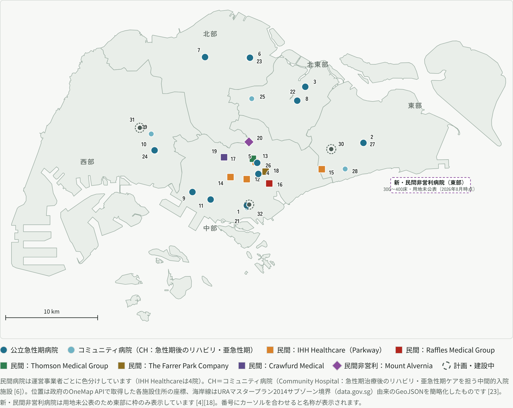

# シンガポールの医療提供体制 ― GP・ポリクリニック・公立病院・民間病院・その他クリニックと主要病院マップ

**作成日**: 2026年10月22日
**調査方法**: シンガポール保健省（MOH）の公式ページ・統計・大臣スピーチを一次資料として英語で調査し、日本語で整理した。各記述の末尾に根拠番号 [n] を付し、末尾の「出典・参考URL」に対応させている。病床数など一部は二次情報（Wikipedia、報道、企業年次報告）に依拠しており、その旨を明記した。
**関連ファイル**:
- インタラクティブ版（白地図＋番号にカーソルで名称表示）: `20261022_singapore_healthcare_map.html`
- 白地図画像: `20261022_singapore_hospital_map.png` ／ SVG: `20261022_singapore_hospital_map.svg`
- 施設座標データ（OneMap API取得）: `20261022_singapore_hospitals_coords.json`

---

## 要約

1. **二層構造**: 初期診療（プライマリケア）は民間GPクリニックが約8割、公立ポリクリニックが約2割を担う一方、急性期入院は公立病院が病床の約8割・患者の約9割を受け持つ。公立病院は稼働率90%超、民間病院は「半分程度」の稼働にとどまる [3][4]。
2. **規模（2025年）**: 民間GPクリニック2,777、公立ポリクリニック27、急性期病院20（公立11・非営利1・民間8）、精神科病院1、コミュニティ病院10（公立6・非営利4）、ナーシングホーム91 [2][5]。
3. **公立の運営**: SingHealth（東部）、NHG Health（中部・北部）、NUHS（西部）の3クラスターが急性期病院・国立専門センター・コミュニティ病院・ポリクリニックを地域ごとに一体運営する [5][12]。
4. **民間病院**: IHH Healthcare（Parkway）系4院、Raffles、Thomson、Farrer Park、Crawfurdの営利8院と、唯一の非営利急性期病院Mount Alverniaの計9院 [5][15][16]。
5. **新設・予定地**: 公立はEastern General Hospital Campus（Bedok North、2029年〜、約1,400床）とTengah General and Community Hospital（2030年代初頭）で急性期病院を11→13に増やし、2025〜2030年に計13,600床（うち公立急性期・コミュニティ約2,800床）を追加する [7][8]。民間は約20年ぶりに東部で非営利急性期病院（300〜400床）向けの用地が放出される方針で、2026年後半に入札判断、具体地は未公表 [4][18]。

---

## 1. 全体像：患者の流れ

| 段階 | 担い手 | 要点 | 出典 |
|---|---|---|---|
| 初期診療 | 民間GPクリニック（2,777） | 受診の約80%。CHAS登録1,300超で補助診療が可能。Healthier SGのかかりつけ登録先 | [1][2][3] |
| 初期診療（公立） | ポリクリニック（27→2030年に32） | 補助付き初期診療・慢性疾患管理・予防・薬剤 | [1][2][7] |
| 専門外来・救急 | 公立病院の専門外来（SOC）・救急部門（ED） | ポリクリニック・CHAS GP等からの紹介で市民30〜70%補助。GPFirst紹介でED受診料S$50補助 | [3][10] |
| 急性期入院 | 公立病院11（総合9＋女性小児1＋精神科1）、民間病院9 | 公立が病床の約80%・患者の約90%。補助病棟（B2/C）は市民最大80%補助 | [4][5][19] |
| 回復期・亜急性期 | コミュニティ病院10（公立6・非営利4） | リハビリ・亜急性期ケア。急性期病院に併設が多い | [2][6] |
| 長期ケア | ナーシングホーム91、通所174、在宅26事業者 | 2030年までにナーシングホーム10,600床追加 | [2][7] |

---

## 2. GP（General Practitioner：民間開業医）

- **規模と役割**: MOHは民間GPクリニックを2,000超（統計では2025年に2,777か所）とし、プライマリケア需要の約80%を担うとしている [1][2][3]。認定家庭医の約半数は民間で開業している [4]。2010年のMOHプライマリケア調査でも受診の81%がGP、19%がポリクリニックであった [28]。
- **CHAS（Community Health Assist Scheme）**: 1,300超のGPクリニックが参加し、CHASカード保有者は民間GPでも補助を受けられる。うち1,000超のCHAS GPは8つのファミリーメディシン・クリニックを含む10のプライマリケア・ネットワーク（PCN）に組織され、糖尿病・高血圧・脂質異常症などを看護師・ケアコーディネーターの支援付きで管理する [1]。
- **Healthier SG（2023年7月〜）**: 40歳以上の居住者が1人のかかりつけGP／ポリクリニックに登録し、健診・予防接種・生活習慣改善を含む個別ヘルスプランを受ける国家予防プログラム。2026年4月までに140万人超が登録し、1,100超のプライマリケア機関が参加 [14]。
- **病院への入口**: GPFirstでは、GPが救急部門（ED）受診を要すると判断して紹介した場合、ED受診料がS$50補助され非緊急例より優先される [3]。CHAS GPから公立病院専門外来（SOC）への紹介も補助対象 [10]。2014〜2023年の10年間で公立SOCへの紹介はポリクリニックから390万件、GPから74万件で、GP紹介は年6.5万件から8.8万件に増加 [11]。
- **許認可**: 2020年Healthcare Services Act（HCSA）により施設単位からサービス単位の許可制に移行し、外来医療サービスは2023年6月26日開始の第2フェーズで同法の下に移行した [27]。

## 3. ポリクリニック（公立の初期診療拠点）

- MOHは「26か所のポリクリニックが補助付きの初期診療、慢性疾患管理、感染症管理、小児保健、予防、アライドヘルス、検査、薬剤サービスを提供する」としている（統計では2025年27か所） [1][2]。
- 運営主体は3クラスターのポリクリニック部門（NHG Polyclinics、SingHealth Polyclinics、National University Polyclinics）。2017年1月の再編で地域別（中部・東部・西部）に整理された [12]。
- 2030年までに32か所へ拡充。2027年までにBidadari、Kaki Bukit、Serangoon、Tengah、Yew Teeに新設、2030年までにBishan、Taman Jurongに新設、Bukit Merah、Clementi、Jurong、Outram、Queenstown、Toa Payohを再開発（Bukit MerahとOutramは統合） [7]。
- 2010年調査では受診シェア19%にとどまる一方、慢性疾患受診の45%をポリクリニックが担っていた [28]。

## 4. 公立病院

MOHによれば公立病院は11（総合病院9、女性・小児病院1、精神科病院1）。総合病院は多職種による入院、在宅入院（MIC@Home）、専門外来を提供し、Alexandra病院を除く全総合病院に24時間救急部門がある。加えて、がん・心臓・眼・皮膚・神経・感染症・歯科の国立専門センターが10ある [5]。公立病院病床は12,000床超で、2025〜2030年に急性期・コミュニティ病院で約2,800床を増やし、公立急性期病院は2030年代初頭に13、コミュニティ病院は12になる [7]。

**3つの統合クラスター（2017年1月再編）** [12]

| クラスター | 担当地域 | 急性期病院（地図番号） | ポリクリニック部門 |
|---|---|---|---|
| SingHealth | 東部 | SGH(1)、CGH(2)、SKH(3)、KKH(4) | SingHealth Polyclinics |
| NHG Health | 中部・北部 | TTSH(5)、KTPH(6)、Woodlands Health(7)、IMH(8) | NHG Polyclinics |
| NUHS | 西部 | NUH(9)、NTFGH(10)、AH(11) | National University Polyclinics |

※各病院の所属はMOHの2017年再編発表（統合元の各グループ）と各院の公表情報に基づく整理 [12][16]。

**病棟クラスと補助**: 公立病院の補助病棟（B2／C）は資力調査に基づき市民最大80%、永住者最大50%の補助。A／B1病棟は無補助 [19]。専門外来（SOC）の補助は市民30〜70%、永住者25%で、A&E・入院・ポリクリニック・CHAS GPからの紹介が条件 [10]。

## 5. 民間病院

MOHは民間病院を9（うち非営利1）と数える [5]。統計上は急性期病院20のうち公立11、非営利1、民間8 [2]。

| 地図No. | 病院 | 運営主体 | 所在 | 病床（出典） | 備考 |
|---|---|---|---|---|---|
| 12 | Mount Elizabeth Hospital | IHH Healthcare（Parkway） | Orchard | IHH 4院計697（稼働床、2024年）[15] | 1979年開業 [16] |
| 13 | Mount Elizabeth Novena Hospital | IHH Healthcare（Parkway） | Novena | 同上 | 2012年開業。2008年の用地入札で建設 [4][16] |
| 14 | Gleneagles Hospital | IHH Healthcare（Parkway） | Tanglin | 同上 | 1957年開業 [16] |
| 15 | Parkway East Hospital | IHH Healthcare（Parkway） | Joo Chiat | 同上 | 東部唯一のIHH病院 [15] |
| 16 | Raffles Hospital | Raffles Medical Group | Bugis | 380（Wikipedia）[16] | グループの旗艦病院 [20] |
| 17 | Thomson Medical Centre | Thomson Medical Group（SGX上場） | Thomson Rd | 187（Wikipedia）[16] | 産科・小児中心 [22] |
| 18 | Farrer Park Hospital | The Farrer Park Company | Farrer Park駅上 | 121（Wikipedia）[16] | ホテル一体型複合開発 [21] |
| 19 | Crawfurd Hospital | Crawfurd Medical | Adam Rd | 31（Wikipedia）[17] | 2012年Fortis Colorectal→2015年Concord International→2021年現名称 [17] |
| 20 | Mount Alvernia Hospital（非営利） | フランシスコ会系の非営利法人 | Thomson Rd | 350超 [4] | 1961年60床で開院。唯一の民間非営利急性期病院 [4] |

- **IHH（Parkway）**は4病院で2024年に稼働床697、入院61,909件、稼働率66%（2023年61%）。病床拡張が制約されるため低重症度ケアを外来センターへ移し、東部で200床の移行期ケア施設（TCF@East）を着工 [15]。
- **需要側**: 居住者の約40%が民間病院向け医療保険を購入しているが、その約半数は公立病院を選ぶ [4]。
- **新規参入**: 政府は約20年ぶりに東部で民間非営利急性期病院（300〜400床）向け用地を放出する方針。固定価格入札（ケアモデル・コスト効率・人材育成・手頃さで評価）と請求額の市場上位パーセンタイルへの制限を条件とし、2026年後半に入札判断 [4]。2026年8月31日の報道ではMOHが適地を特定済みで、入札詳細は年末までに公表予定、具体地は未公表 [18]。

## 6. コミュニティ病院とその他のクリニック・施設

- **コミュニティ病院（10：公立6・非営利4）**: 急性期治療後のリハビリ・亜急性期ケアを担う中間的入院施設。脳卒中・骨折・人工関節後のリハビリや、肺炎・心不全などの亜急性期治療、一部は認知症ケア・透析・ホスピスも提供 [2][6]。公立はOutram、Sengkang、Yishun、Jurongなど急性期病院に併設、非営利はAng Mo Kio-Thye Hua Kwan、Ren Ci、St Andrew's、St Luke's [16]。2025年にSt Andrew'sのBedok新病院（240床、うち140床は移行期ケア床）が開設 [7]。
- **専門クリニック**: 公立病院・国立専門センターの専門外来（SOC）と、民間専門医クリニック。公立SOCの補助は紹介元を条件とし、民間専門医は無補助 [10]。
- **歯科**: 民間歯科クリニック1,046、公立251（ポリクリニック15、病院10、学校歯科226）（2025年）。CHASは歯科にも適用 [1][2]。
- **中医（TCM）**: 登録TCM医師3,242人（実働2,276人、2024年） [13]。
- **薬局・在宅**: 薬局250（公立75・民間175）、在宅医療・看護26事業者、在宅緩和ケア9事業者（2025年） [2]。MIC@Home（在宅入院）は200床相当を展開済み [7]。
- **長期ケア**: ナーシングホーム91（公立38・非営利23・民間30）、通所系174（2025年） [2]。
- **人材**: 医師17,582人（公立11,233・非公立5,031）、看護師・助産師50,389人、歯科医2,812人、薬剤師4,283人（2024年）。医師の約3分の2が公立勤務 [13]。

## 7. 白地図：主要病院と新設予定地

凡例: ●濃青＝公立急性期病院、●水色＝コミュニティ病院（CH）、■＝民間病院を運営事業者別に色分け（橙＝IHH Healthcare/Parkway 4院、赤＝Raffles Medical Group、緑＝Thomson Medical Group、黄土＝The Farrer Park Company、藍紫＝Crawfurd Medical）、◆紫＝民間非営利（Mount Alvernia）、◌破線＝計画・建設中。CH＝コミュニティ病院（Community Hospital）で、急性期治療後のリハビリ・亜急性期ケアを担う中間的入院施設 [6]。位置は政府のOneMap APIで取得した各施設住所の座標、海岸線はURAマスタープラン2014サブゾーン境界（data.gov.sg）由来のGeoJSONを簡略化 [23]。新・民間非営利病院は用地未公表のため東部に枠のみ表示 [4][18]。

| No. | 区分 | 施設 | 運営 | 備考（出典） |
|---|---|---|---|---|
| 1 | 公立 | Singapore General Hospital (SGH) | SingHealth | Outramキャンパスに国立がん・心臓・眼・歯科センターが集積 [5][16] |
| 2 | 公立 | Changi General Hospital (CGH) | SingHealth | 改修で2027年までに160床追加 [7] |
| 3 | 公立 | Sengkang General Hospital (SKH) | SingHealth | 2018年開業。2026年から約140床追加 [7][16] |
| 4 | 公立 | KK Women's and Children's Hospital (KKH) | SingHealth | 女性・小児病院 [5] |
| 5 | 公立 | Tan Tock Seng Hospital (TTSH) | NHG Health | Medical Tower新設予定 [8] |
| 6 | 公立 | Khoo Teck Puat Hospital (KTPH) | NHG Health | 2010年開業 [16] |
| 7 | 公立 | Woodlands Health (WH) | NHG Health | 2023年12月開業、約1,000床→最大1,800床。2030年までに約400床追加 [7][26] |
| 8 | 公立 | Institute of Mental Health (IMH) | NHG Health | 唯一の精神科病院 [5] |
| 9 | 公立 | National University Hospital (NUH) | NUHS | Kent Ridge再開発：2033年までに1,200床の半分を建替え＋約100床、2038年に計1,500床 [7] |
| 10 | 公立 | Ng Teng Fong General Hospital (NTFGH) | NUHS | 2015年開業 [16] |
| 11 | 公立 | Alexandra Hospital (AH) | NUHS | 再開発後2028年から段階開業、計1,300床へ [5][7] |
| 12〜15 | 民間（IHH） | Mount Elizabeth／Mount Elizabeth Novena／Gleneagles／Parkway East | IHH Healthcare（Parkway） | 4院で稼働床697（2024年） [15] |
| 16 | 民間（Raffles） | Raffles Hospital | Raffles Medical Group | [16][20] |
| 17 | 民間（Thomson） | Thomson Medical Centre | Thomson Medical Group | [16][22] |
| 18 | 民間（Farrer Park） | Farrer Park Hospital | The Farrer Park Company | [16][21] |
| 19 | 民間（Crawfurd） | Crawfurd Hospital | Crawfurd Medical | [17] |
| 20 | 非営利 | Mount Alvernia Hospital | 非営利 | 350床超 [4] |
| 21 | コミュニティ病院（CH） | Outram Community Hospital | SingHealth | SGH併設 [16] |
| 22 | コミュニティ病院（CH） | Sengkang Community Hospital | SingHealth | SKH併設 [16] |
| 23 | コミュニティ病院（CH） | Yishun Community Hospital | NHG Health | KTPH併設 [16] |
| 24 | コミュニティ病院（CH） | Jurong Community Hospital | NUHS | NTFGH併設 [16] |
| 25 | コミュニティ病院（CH） | Ang Mo Kio-Thye Hua Kwan Hospital | 非営利 | [16] |
| 26 | コミュニティ病院（CH） | Ren Ci Community Hospital | 非営利 | Novena [16] |
| 27 | コミュニティ病院（CH） | St Andrew's Community Hospital（Simei） | 非営利 | CGH隣接 [16] |
| 28 | コミュニティ病院（CH） | St Andrew's Community Hospital（Bedok） | 非営利 | 2025年開設、240床 [7] |
| 29 | コミュニティ病院（CH） | St Luke's Hospital | 非営利 | Bukit Batok [16] |
| 30 | 計画 | Eastern General Hospital Campus（急性期＋コミュニティ） | SingHealth（公立） | Bedok North駅隣接。2024年4月20日起工、2029年から段階開業、全面開業時約1,400床 [7][8][9] |
| 31 | 計画 | Tengah General and Community Hospital | NUHS（公立） | Tengah Garden Avenue沿い。2030年代初頭完成目標 [7][8] |
| 32 | 計画 | SGH Elective Care Centre＋新National Dental Centre | SingHealth（公立） | Second Hospital Avenue。2027年までに300床 [7][8] |
| — | 計画（民間非営利） | 新・民間非営利急性期病院（東部） | 入札で選定（未定） | 300〜400床。2026年後半に入札判断、用地は未公表 [4][18] |

**予定地に関する注記**: 「計画」マーカーはMOHの「2026年以降の施設」ページに記載の住所・位置説明をOneMapで座標化したもので、敷地の正確な範囲ではない [8][23]。Alexandra病院再開発(11)、NUH Kent Ridge再開発(9)、TTSH Medical Tower(5)は既存病院の敷地内のため既存マーカーに含めた。

## 8. 2030年までの供給拡大計画（MOH、2025年3月7日）[7]

| 項目 | 内容 |
|---|---|
| 病床総増加 | 2025〜2030年に13,600床（公立急性期・コミュニティ病院約2,800床、ナーシングホーム10,600床など）。既存公立病院病床は12,000床超 |
| 急性期病院数 | 公立11→13（Eastern General Hospital、Tengah） |
| コミュニティ病院数 | 公立・VWO 10→12 |
| ポリクリニック | 26（2024年末）→32（2030年） |
| 2020年以降の実績 | 6,300床超を拡充（急性期1,200超、コミュニティ600、ナーシングホーム4,300超、MIC@Home 200） |

---

## 出典・参考URL

- [1] MOH, "Primary care": https://www.moh.gov.sg/seeking-healthcare/find-a-facility-or-service/types-of-medical-facilities-and-services/primary-care-services/
- [2] MOH, "Health Facilities" 統計（2023〜2025年）: https://www.moh.gov.sg/others/resources-and-statistics/health-facilities/
- [3] MOH, "Seeking a doctor": https://www.moh.gov.sg/seeking-healthcare/getting-medical-help/seeking-a-doctor/
- [4] MOH, Speech by Mr Ong Ye Kung at Mount Alvernia Hospital's 65th Anniversary, 9 April 2026: https://www.moh.gov.sg/newsroom/speech-by-mr-ong-ye-kung--minister-for-health-and-coordinating-minister-for-social-policies--at-mount-alvernia-hospital-s-65th-anniversary-celebration-and-official-opening-of-upgraded-facilities/
- [5] MOH, "Acute hospitals": https://www.moh.gov.sg/seeking-healthcare/find-a-facility-or-service/types-of-medical-facilities-and-services/acute-hospitals/
- [6] MOH, "Community hospitals": https://www.moh.gov.sg/seeking-healthcare/find-a-facility-or-service/types-of-medical-facilities-and-services/community-hospitals/
- [7] MOH, "Expanding Healthcare Capacity and Transforming the Healthcare Workforce", 7 March 2025: https://moh.gov.sg/newsroom/expanding-healthcare-capacity-and-transforming-the-healthcare-workforce
- [8] MOH, "Facilities from 2026 onwards": https://www.moh.gov.sg/seeking-healthcare/find-a-facility-or-service/types-of-medical-facilities-and-services/find-a-medical-facility/facilities-from-2026-onwards/
- [9] MOH, Speech at the Groundbreaking Ceremony for Eastern General Hospital Campus, 20 April 2024: https://www.moh.gov.sg/newsroom/speech-by-mr-ong-ye-kung--minister-for-health--at-the-groundbreaking-ceremony-for-eastern-general-hospital-campus--20-april-2024--900-am/
- [10] MOH, "Subsidies for Specialist Outpatient care at Public Healthcare Institutions": https://www.moh.gov.sg/managing-expenses/schemes-and-subsidies/subsidies-for-specialist-outpatient-care-at-public-healthcare-institutions/
- [11] MOH, "Number of referrals to specialist clinics by polyclinics and GPs..."（国会答弁、2024年）: https://www.moh.gov.sg/newsroom/number-of-referrals-to-specialist-clinics-by-polyclinics-and-gps--and-difference-in-subsidies-granted-for-such-referrals/
- [12] MOH, "Reorganisation of Healthcare System into Three Integrated Clusters", 18 January 2017: https://www.moh.gov.sg/newsroom/reorganisation-of-healthcare-system-into-three-integrated-clusters-to-better-meet-future-healthcare-needs/
- [13] MOH, "Health Manpower" 統計: https://www.moh.gov.sg/others/resources-and-statistics/health-manpower/
- [14] MOH, Speech by Mdm Rahayu Mahzam at Duke-NUS Class of 2026 Graduation, 30 May 2026: https://www.moh.gov.sg/newsroom/speech-by-mdm-rahayu-mahzam--minister-of-state--ministry-of-digital-development-and-information-and-ministry-of-health--at-the-duke-nus-class-of-2026-graduation-ceremony--30-may-2026/ ／ WHO WHA79 Singapore statement: https://apps.who.int/gb/statements/WHA79/PDF/Singapore-12.5.pdf
- [15] IHH Healthcare Annual Report 2024: https://www.insage.com.my/interactiveAR/IHH/interactiveAR2024/41/ ／ https://www.insage.com.my/interactiveAR/IHH/interactiveAR2024/46/
- [16] Wikipedia, "List of hospitals in Singapore"（二次情報）: https://en.wikipedia.org/wiki/List_of_hospitals_in_Singapore
- [17] Wikipedia, "Crawfurd Hospital"（二次情報）: https://en.wikipedia.org/wiki/Crawfurd_Hospital
- [18] AsiaOne, "New private not-for-profit hospital planned for eastern Singapore as demand for beds remains high", 31 August 2026（報道）: https://www.asiaone.com/singapore/new-private-not-for-profit-hospital-eastern-singapore-bed-demand
- [19] MOH, "Subsidies for Acute Inpatient Care at Public Healthcare Institutions": https://www.moh.gov.sg/managing-expenses/schemes-and-subsidies/subsidies-for-acute-inpatient-care-at-public-healthcare-institutions/
- [20] Raffles Medical Group, "Raffles Hospital": https://www.rafflesmedicalgroup.com/hospital/
- [21] Farrer Park Hospital, "About Us": https://www.farrerpark.com/about-us.html
- [22] Thomson Medical, "About Us": https://www.thomsonmedical.com/about-us
- [23] 座標: OneMap Search API（Singapore Land Authority）: https://www.onemap.gov.sg/apidocs/ ／ 海岸線GeoJSON: https://github.com/yinshanyang/singapore（出典 data.gov.sg MP14_SUBZONE_WEB_PL）
- [26] Woodlands Health, "Progressive Opening Media Release", 22 December 2023: https://www.wh.com.sg/AboutUs/newsroom/Documents/WH%20Progressive%20Opening%20Media%20Release_22%20Dec%202023.pdf
- [27] MOH, "Phase 2 of Healthcare Services Act to start on 26 June 2023": https://www.moh.gov.sg/newsroom/phase-2-of-healthcare-services-act-to-start-on-26-june-2023/
- [28] MOH, "Primary Care Utilisation"（2010年プライマリケア調査）: https://www.moh.gov.sg/newsroom/primary-care-utilisation/

注: 病床数は出典により「許可病床」「稼働病床」の定義が異なる。Wikipedia由来の数値は二次情報として明記した。本資料は2026年10月22日時点の公開情報に基づく。
