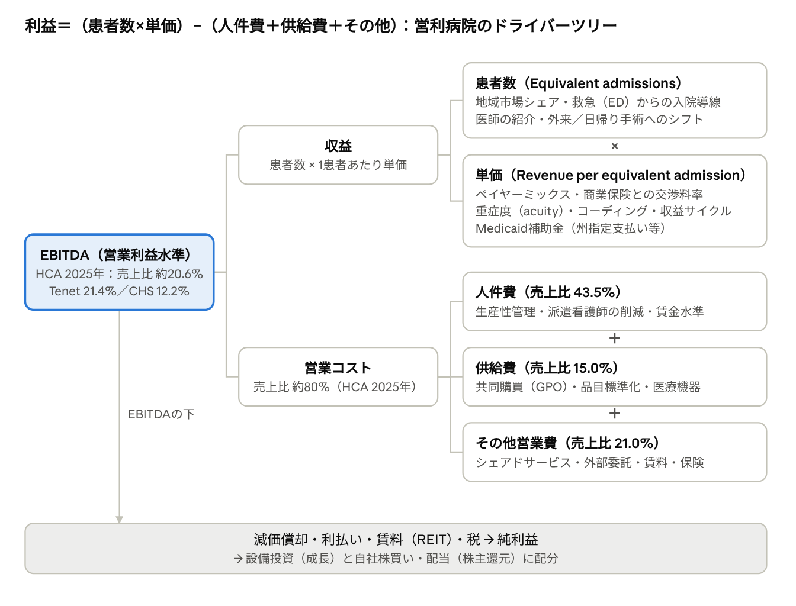

# 民間営利急性期病院の経営手法：米・豪・欧・アジア比較

作成日：2026年10月29日 · 作成：Taku Murakami（Claude Codeによる調査）

## エグゼクティブサマリー

民間営利急性期病院の利益は「患者数×単価－（人件費＋供給費＋その他営業費）」で決まり、経営レバーはこの式の各項に対応する。米国最大手HCAは2025年に売上756億ドル、調整後EBITDA率約20.6%を計上し、営利病院の全保険者ベース営業利益率は14.5%と非営利の5.9%を大きく上回る（MedPAC、2024年度）。

- **収益側のレバー**は、商業保険加入者の多い地域への集中立地、救急外来と医師紹介による患者導線、保険者との料率交渉、重症度・コーディングの最適化、高収益診療領域と外来手術へのミックスシフトである。米国の商業保険価格はMedicareの254%で、交渉力の源泉は地域市場シェアである。
- **コスト側のレバー**は、売上の4割を占める人件費の生産性管理と派遣削減、共同購買、シェアドサービス、そして負債と不動産を使った資本効率の追求である。MedPACは営利の優位を「低い平均時給を含むコスト抑制」に求める。
- **制度がレバーを決める。** 単価を交渉で動かせるのは米国（と限定的に豪・英）だけであり、ドイツ・フランスの公定価格下では量・ミックス・コストだけが残る。利益率も米国約20%、英Spire約18%、独Helios・豪Ramsay約9%とこの差を反映する。
- **保険者との関係**は、米国では病院側が市場集中と契約解除予告を武器に毎年の料率引き上げを確保する一方、豪州では保険者側が強く、料率がコストに追いつかずHealthscopeが2025年に破綻した。
- **医師との関係**は、米国は雇用（医師の約8割）と外来手術センターの共同所有で紹介を内部化し、豪・英・仏・アジアでは独立開業医に設備と場所を提供して選んでもらう。各国の法規制は「紹介への対価」を禁じる点で共通する。
- **ステークホルダー間のバランス**は、経営陣の自律ではなく外部の制約（CON法、州司法長官の買収条件、労組、公開品質指標）で保たれている。実証研究は営利病院が利益機会に最も敏感に反応することを示すが、チャリティケアでは非営利を上回る。
- **最大のリスクは資本構成**である。Steward（2024年）、Prospect（2025年）、Healthscope（2025年）の破綻はいずれも不動産のセール＆リースバックと配当による資本流出が原因で、PE買収後に人員を大幅削減した病院では有害事象が25%増えたという研究もある。

詳細は以下の各章で、各数値に出典URLを付して述べる。

## 制度背景：各国の営利病院の位置づけ

営利病院の経営手法は「誰が病院に金を払い、単価を誰が決めるか」で決まる。米国は商業保険との個別交渉で単価を動かせる唯一の大市場であり、豪州・英国は民間保険との交渉と公的契約の併用、ドイツ・フランスは国が単価を固定するため量・ミックス・コストだけが経営レバーになる。アジアは自費・医療ツーリズムの比重が高く、価格設定の自由度が最も大きい。

| 国 | 営利病院のシェア | 主な資金源・単価の決まり方 | 主要プレイヤー（直近売上） | 出典 |
| --- | --- | --- | --- | --- |
| 米国 | コミュニティ病院5,121のうち投資家所有1,224（23.9%、2024年調査） | Medicare・Medicaidは公定価格、商業保険は個別交渉。HCAの売上の48.9%が商業保険、45.4%が公的保険 | [HCA](https://www.sec.gov/Archives/edgar/data/860730/000119312526044769/hca-20251231.htm) 190病院・756億ドル、[Tenet](https://www.sec.gov/Archives/edgar/data/70318/000007031826000012/thc-20251231.htm) 50病院＋533外来手術センター・213億ドル、[CHS](https://www.sec.gov/Archives/edgar/data/1108109/000119312526059509/cyh-20251231.htm) 69病院・125億ドル、[UHS](https://www.sec.gov/Archives/edgar/data/352915/000119312526071676/uhs-20251231.htm) 急性期29＋精神科182施設 | [AHA Fast Facts 2026](https://www.aha.org/statistics/fast-facts-us-hospitals) |
| 豪州 | 民間病院631（2024年12月）。全入院の41%、待機手術入院の58%が民間病院（2023-24年度） | 民間医療保険（人口の45.8%が加入、2026年6月）と各保険者が病院ごとに結ぶ契約（HPPA）。政府は保険料に補助金を出すが病院には直接払わない | [Ramsay Health Care](https://www.ramsayhealth.com/globalassets/global/investor-centre/investor-centre-pdfs/fy26-investor-presentation--speech-fy26-results-briefing.pdf) 豪州44病院・顧客売上52.5億豪ドル（FY26）、[Healthscope](https://en.wikipedia.org/wiki/Healthscope) 37施設（2025年5月に管財人管理） | [保健省 2025年1月協議文書](https://consultations.health.gov.au/private-hospitals-branch/private-health-reform-options-dec2024/user_uploads/consultation-paper---private-health-reform-options---january-2025-1.pdf) / [AIHW](https://www.aihw.gov.au/news-media/media-releases/2025/2025-may/hospital-admission-rates-in-australia-have-increased) / [APRA](https://www.apra.gov.au/quarterly-private-health-insurance-membership-and-benefits-summary-june-2026) |
| ドイツ | 1,841病院のうち民間営利738（約40%）、病床では約21%（2024年） | 公的医療保険が全国一律のG-DRG価格で支払う。単価交渉の余地はなく、量・ケースミックス・コストで差がつく | [Fresenius Helios](https://report.fresenius.com/2024/annual-report/group-management-report/economic-report/results-of-operations.html) ドイツ売上76.6億ユーロ（2024年）、[Asklepios](https://en.wikipedia.org/wiki/Asklepios_Kliniken) 59.6億ユーロ、[Sana](https://de.wikipedia.org/wiki/Sana_Kliniken) 36億ユーロ | [Destatis](https://www.destatis.de/EN/Themes/Society-Environment/Health/Hospitals/_node.html) / [KGNW（Destatis集計）](https://www.kgnw.de/download/krankenhaeuser-und-betten-2024) |
| 英国 | 民間急性期市場137.9億ポンド、うち独立系病院72.1億ポンド（2024年） | 民間医療保険（PMI）、NHS委託（公定タリフ）、自費の3本柱。2012年時点でPMI 55%、NHS 27.5%、自費14.5% | [Spire Healthcare](https://www.spirehealthcare.com/about-spire-healthcare/) 38病院・売上15.8億ポンド（2025年）、Circle Health（PureHealth傘下）、HCA UK、Nuffield Health（慈善団体） | [LaingBuisson](https://go.laingbuisson.com/private-acute-report-10) / [CMA最終報告 2014](https://assets.publishing.service.gov.uk/media/533af065e5274a5660000023/Private_healthcare_main_report.pdf) |
| フランス | 民間営利クリニック980（2024年末）。手術病床の約40%、日帰り手術枠の約61% | 国が定めるT2A（活動別）タリフ。医師は自由業で患者に直接請求し、施設使用料（redevance）をクリニックに支払う | [Ramsay Santé](https://fr.wikipedia.org/wiki/Ramsay_Sant%C3%A9) 売上53.8億ユーロ（2026年6月期）、[Elsan](https://fr.wikipedia.org/wiki/Elsan)（KKR主導） | [DREES SAE 2024](https://www.drees.solidarites-sante.gouv.fr/sites/default/files/2025-11/ER1353%20-%20SAE%20-%20MEL2.pdf) |
| アジア | シンガポールは急性期病床の約13%が民間（2025年）。タイ・マレーシアは自費・保険・外国人患者が中心 | 自費・民間保険・医療ツーリズム。シンガポールは保健省の料金ベンチマーク（非強制、約90%の医師が範囲内） | [IHH Healthcare](https://links.sgx.com/1.0.0/corporate-announcements/EPIRPXM7XCIAO1SE/834831_IHH%20Q4%202024_Press%20Release%2027.02.2025.pdf) 売上244億リンギ・89病院（2024年）、[BDMS](https://en.wikipedia.org/wiki/Bangkok_Dusit_Medical_Services) 売上1,094億バーツ、[Apollo Hospitals](https://en.wikipedia.org/wiki/Apollo_Hospitals) | [シンガポール保健省](https://www.moh.gov.sg/newsroom/new-fee-benchmarks-for-private-healthcare-sector/) / [data.gov.sg](https://data.gov.sg/datasets/d_852ebeb1165d0ec4cdc89fa7742959d1/view) |

米国の営利病院は病院数で約4分の1だが、収益性では非営利を大きく上回る。MedPACの集計では2024年度の全保険者ベース営業利益率は営利14.5%、非営利5.9%であった。[MedPAC 2026年3月報告](https://www.medpac.gov/wp-content/uploads/2026/03/Mar26_Ch3_MedPAC_Report_To_Congress_SEC.pdf)

ドイツでは同じDRG価格の下で、2024年に全病院の66%が赤字決算となる一方（DKI病院バロメーター）、Heliosドイツ事業はEBIT率8.6%、AsklepiosはEBITDA率9.6%を確保した。価格が固定された市場でも営利チェーンが利益を出せることは、コスト構造とケースミックスが単価以上に重要であることを示す。[Fresenius 2024年報](https://report.fresenius.com/2024/annual-report/group-management-report/economic-report/results-of-operations.html) / [KGNW（DKI調査）](https://www.kgnw.de/download/2025-12-29-pm-dki-krankenhausbarometer-pdf)

## 病院事業の利益構造：利益の方程式

営利病院の利益は「患者数 × 単価」で決まる収益から、売上の約8割を占める人件費・供給費・その他営業費を差し引いたEBITDAで測られ、その下で利払い・賃料・税を経て株主還元と再投資に配分される。米国最大手HCA Healthcareの2025年10-Kは、売上756億ドルの増加要因を「equivalent admissions（外来を入院換算した患者数）の2.9%増と、1 equivalent admissionあたり収益の4.0%増の組み合わせ」と説明しており、経営陣自身が収益を「量 × 単価」で管理していることが分かる。[HCA FY2025 10-K](https://www.sec.gov/Archives/edgar/data/860730/000119312526044769/hca-20251231.htm)

左の結果（EBITDA）から右へ分解するほど、現場が日々動かせるレバーになる。収益側は患者数と単価、コスト側は人件費・供給費・その他営業費の3費目で、EBITDAの下には資本構成（負債・不動産）の層がある。

### 主要チェーンの実績値（2025年度）

| 指標 | HCA | Tenet | CHS | 出典 |
| --- | --- | --- | --- | --- |
| 売上高（億ドル） | 756.0 | 213.1 | 124.9 | 各社10-K |
| 人件費（売上比） | 43.5% | 40.8% | 43.3% | 各社10-K |
| 供給費（売上比） | 15.0% | 17.7% | 14.9% | 各社10-K |
| その他営業費（売上比） | 21.0% | 21.2% | 27.6% | 各社10-K |
| 調整後EBITDA率 | 約20.6%（155.7億ドル） | 21.4%（病院15.7%／外来39.2%） | 12.2% | 各社決算資料 |
| 利払い（億ドル） | 22.5 | 8.2 | 8.7（純額） | 各社10-K |
| 自社株買い（億ドル） | 100.7 | 13.9 | 開示なし | 各社10-K |

出典：[HCA 10-K](https://www.sec.gov/Archives/edgar/data/860730/000119312526044769/hca-20251231.htm)、[HCA 2025年第4四半期決算](https://www.sec.gov/Archives/edgar/data/860730/000119312526023323/hca-ex99_1.htm)、[Tenet 10-K](https://www.sec.gov/Archives/edgar/data/70318/000007031826000012/thc-20251231.htm)、[Tenet 第4四半期決算](https://www.sec.gov/Archives/edgar/data/70318/000007031826000007/thc-20251231ex991earningsr.htm)、[CHS 10-K](https://www.sec.gov/Archives/edgar/data/1108109/000119312526059509/cyh-20251231.htm)。

### 営利と非営利の利益率格差

米国の公的諮問機関MedPAC（Medicare Payment Advisory Commission）の2026年3月報告によると、2024年度の全保険者ベース営業利益率は営利病院14.5%、非営利病院5.9%であった。Medicare（高齢者向け公的保険）のみの利益率でも営利は+1.1%、非営利は−13.4%で、MedPACはその一因を「営利病院の平均時給が低いこと」と「人件費その他のコスト抑制」に求めている。[MedPAC 2026年3月報告 第3章](https://www.medpac.gov/wp-content/uploads/2026/03/Mar26_Ch3_MedPAC_Report_To_Congress_SEC.pdf)

Tenetの2025年実績は、同じ会社の中でも病院事業のEBITDA率15.7%に対し、外来手術センター（USPI）事業は39.2%と2.5倍の差があることを示す。利益率を決めるのは「どの事業・診療領域にポートフォリオを寄せるか」であり、これが後述するミックス戦略の根拠となる。[Tenet 第4四半期決算](https://www.sec.gov/Archives/edgar/data/70318/000007031826000007/thc-20251231ex991earningsr.htm)

## 収益側レバー：患者数・単価・ミックス

収益側で最も大きいレバーは「どの保険者の、どの診療領域の患者を、どの場（入院か外来か）で治療するか」というミックスの選択であり、営利チェーンはこれを市場選択・医師導線・診療領域投資で意図的に動かしている。

### ① 患者数（ボリューム）

- **地域市場シェアの確保。** HCAは190病院のうち102をフロリダ・テキサスに集中させ（売上の51%）、「各地域で選ばれる医療システムになるために包括的な地域ネットワークを構築する」ことを戦略の第一に掲げる。市場シェアは患者数だけでなく、後述の保険者交渉力の源泉でもある。[HCA 10-K](https://www.sec.gov/Archives/edgar/data/860730/000119312526044769/hca-20251231.htm)
- **救急外来（ED）を入院の入口にする。** HCAの2025年のER受診は995万件と入院230万件を4倍以上上回る。UHSは35の独立型EDを運営する。一方、2022年には下院議員がHCAのEDからの入院率が全国平均を上回るとする労組の報告を受けてHHSに調査を求めており、ED導線の強化は規制リスクと表裏である。[HCA 10-K](https://www.sec.gov/Archives/edgar/data/860730/000119312526044769/hca-20251231.htm) / [UHS 10-K](https://www.sec.gov/Archives/edgar/data/352915/000119312526071676/uhs-20251231.htm) / [Axios 2022](https://www.axios.com/2022/09/16/congress-federal-probe-hca-hospital-chain)
- **医師の紹介を確保する。** HCAは「病院の競争力を左右する最も重要な要因の2つは医師の数と質」と明記し、最低収入保証を含む医師募集インセンティブを用いる。豪州Ramsayは「入院を生むVMO（非常勤専門医）数」をKPIとしてFY26に3.3%増やし、紹介パターンデータを営業開発に使っている。[HCA 10-K](https://www.sec.gov/Archives/edgar/data/860730/000119312526044769/hca-20251231.htm) / [Ramsay FY26](https://www.ramsayhealth.com/globalassets/global/investor-centre/investor-centre-pdfs/fy26-investor-presentation--speech-fy26-results-briefing.pdf)
- **設備稼働率と病床増。** Ramsayの手術室稼働率は70%（上位5施設は80%超をベストプラクティスとする）で、FY26に22手術室を新設した。IHHは2024年に約1,000床を増やし、今後4年で約4,000床追加する計画で、病床稼働率71%を開示する。[Ramsay FY26](https://www.ramsayhealth.com/globalassets/global/investor-centre/investor-centre-pdfs/fy26-investor-presentation--speech-fy26-results-briefing.pdf) / [IHH 2024年決算](https://links.sgx.com/1.0.0/corporate-announcements/EPIRPXM7XCIAO1SE/834831_IHH%20Q4%202024_Press%20Release%2027.02.2025.pdf)

### ② 単価（1患者あたり収益）

- **ペイヤーミックス。** Tenetは商業保険からの入院単価が公的保険より「約67%高い」と開示し、病院事業の純患者収益の約70%を商業保険から得る。商業保険加入者が多い地域への立地は、それ自体が単価戦略である。[Tenet 2024年10-K](https://www.sec.gov/Archives/edgar/data/70318/000007031825000009/thc-20241231.htm)
- **商業保険との料率交渉。** HCAは「マネジドケア契約は通常1〜3年で、毎年の契約料率引き上げを概ね確保してきた」と述べる。詳細は深掘り①で扱う。[HCA 10-K](https://www.sec.gov/Archives/edgar/data/860730/000119312526044769/hca-20251231.htm)
- **重症度（acuity）とケースミックス。** IHHは成長要因を「患者数とすべての市場でのrevenue intensity（収益密度）の上昇」と説明し、入院あたり収益を国別に開示する。Heliosもドイツの増収要因に「プラスの治疗ミックス効果」を挙げる。インドApolloは稼働病床1日あたり収益（ARPOB）を主要KPIとして公表する。[IHH](https://links.sgx.com/1.0.0/corporate-announcements/EPIRPXM7XCIAO1SE/834831_IHH%20Q4%202024_Press%20Release%2027.02.2025.pdf) / [Fresenius](https://report.fresenius.com/2024/annual-report/group-management-report/economic-report/results-of-operations.html) / [Apollo Q4 FY25](https://mediacdn.apollohospitals.com/sites/default/files/2025-06/transcript-of-apollo-hospitals---q4-fy25-earnings-call---1-.pdf)
- **コーディングと収益サイクル管理。** HCAは収益サイクルをシェアドサービスで集中管理し、売上債標回転日数を54日（2024年）から51日（2025年）に短縮した。Tenetの収益サイクル子会社Coniferは約600の顧客を持ち、フィリピンのグローバルビジネスセンター（約5,600人）に管理業務を移している。ただしコーディングの最適化は「アップコーディング」と紙一重で、営利病院でその傾向が強いことが実証されている（リスクの章参照）。[HCA 10-K](https://www.sec.gov/Archives/edgar/data/860730/000119312526044769/hca-20251231.htm) / [Tenet 10-K](https://www.sec.gov/Archives/edgar/data/70318/000007031826000012/thc-20251231.htm)
- **公的補助金の最大活用。** HCAのMedicaid州指定支払い・補助金収入は2023年44億ドル→2025年62億ドルへと増え、売上の約8%に達する。Tenetは13.4億ドル。2025年の連邦予算法（OBBBA）はこれをMedicare料率の100～110%に上限設定し、HCAは2026年に2.5～4.5億ドルの純減少を見込む。[HCA 10-K](https://www.sec.gov/Archives/edgar/data/860730/000119312526044769/hca-20251231.htm) / [Tenet 10-K](https://www.sec.gov/Archives/edgar/data/70318/000007031826000012/thc-20251231.htm) / [HCA Q4 2025決算説明要約](https://finance.yahoo.com/news/hca-healthcare-inc-hca-q4-210601649.html)

### ③ ミックス（どこで、何を治療するか）

- **高収益診療領域への傾斜。** Horwitzの研究では、営利病院は心臓・整形など収益性の高いサービスを提供し、精神科救急など不採算サービスを避ける傾向が他の所有形態より強い。HCAが名指す重点領域は「腫瘽、脳神経外科、整形外科、産科、診断・救急」である。[Horwitz 2005](https://pubmed.ncbi.nlm.nih.gov/15886174/) / [HCA 10-K](https://www.sec.gov/Archives/edgar/data/860730/000119312526044769/hca-20251231.htm)
- **外来・日帰り手術へのシフト。** HCAの外来収益比率は38.4%（2025年）。Tenetの外来手術センター事業はEBITDA率39.2%と病院事業（15.7%）の2.5倍で、同社は「外来で行われる手術の量と複雑性は今後も増え続ける」と見る。豪州Ramsayは日帰り入院が68.7%を占め、フランスの営利クリニックは日帰り手術枠の61%を保有する。[HCA Q4 2025](https://www.sec.gov/Archives/edgar/data/860730/000119312526023323/hca-ex99_1.htm) / [Tenet Q4 2025](https://www.sec.gov/Archives/edgar/data/70318/000007031826000007/thc-20251231ex991earningsr.htm) / [Ramsay FY26](https://www.ramsayhealth.com/globalassets/global/investor-centre/investor-centre-pdfs/fy26-investor-presentation--speech-fy26-results-briefing.pdf) / [DREES](https://drees.solidarites-sante.gouv.fr/sites/default/files/2026-07/ES%202026%20-%20Fiche%2010%20-%20M%C3%A9decine%2C%20chirurgie%2C%20obst%C3%A9trique%20et%20ondontologie%20-%20activit%C3%A9%20et%20capacit%C3%A9s.pdf)
- **不採算領域からの撤退。** 豪州では2015-16年から2022-23年に9の民間病院が産科病棟を閉鎖し（RANZCOG）、Healthscopeは2025年にダーウィンとホバートの産科を閉じた。RamsayはFY26に精神科入院が3.9%減となり、心理サービス17拠点を閉鎖した。[RANZCOG](https://ranzcog.edu.au/news/private-og-services-under-threat-in-australia-due-to-systemic-gender-bias/) / [豪州助産師協会](https://midwives.org.au/Web/News-media-releases/Articles/2025/20_February/Hobart_Darwin_closures.aspx) / [Ramsay FY25](https://www.ramsayhealth.com/globalassets/global/investor-centre/investor-centre-pdfs/fy25-rhc_investor_presentation_speech-and-slides.pdf)
- **支払者セグメントの選択。** 英Spireは「自費が最も高マージンで、次に民間保険、NHS委託が最も低い」と説明する。タイBDMSは外国人患者が医療サービス収益の29%（2023年）、Bumrungradは約65%を占める。[Spire FY2024](https://investors.spirehealthcare.com/media/awgkz0yq/full-year-results.pdf) / [TRIS Rating](https://trisrating.com/rating-news/tris-rating-affirms-company-senior-unsecured-debt-ratings-bdms-aa-stable-outlook4) / [Bumrungrad IR](https://investor.bumrungrad.com/company_profile.html)

### 経営陣が追う収益KPI

| KPI | 定義 | 使用企業・直近値 | 出典 |
| --- | --- | --- | --- |
| Equivalent admissions / adjusted admissions | 入院数×（入院＋外来総請求）÷入院総請求。外来を入院換算した量 | HCA 410.7万（+2.9%）、CHS 同一施設+0.6% | [HCA](https://www.sec.gov/Archives/edgar/data/860730/000119312526044769/hca-20251231.htm) / [CHS](https://www.sec.gov/Archives/edgar/data/1108109/000119312526059509/cyh-20251231.htm) |
| Revenue per equivalent admission | 入院換算患者あたり収益（単価×ミックス） | HCA 18,314ドル（同一施設+4.1%） | [HCA Q4 2025](https://www.sec.gov/Archives/edgar/data/860730/000119312526023323/hca-ex99_1.htm) |
| Net revenue per case（外来手術） | 手術件数あたり収益 | Tenet USPI +7.1%（件数は+0.3%） | [Tenet](https://www.sec.gov/Archives/edgar/data/70318/000007031826000012/thc-20251231.htm) |
| 外来収益比率 | 患者収益に占める外来 | HCA 38.4%（2024年37.8%） | [HCA Q4 2025](https://www.sec.gov/Archives/edgar/data/860730/000119312526023323/hca-ex99_1.htm) |
| 病床稼働率・手術室稼働率 | 設備の使用率 | HCA 73.1%、IHH 71%、Ramsay手術室70%、Apollo 67% | 各社決算資料（上記） |
| 平均在院日数 | 短いほど病床回転が上がる | HCA 4.751日（2024年4.841日） | [HCA Q4 2025](https://www.sec.gov/Archives/edgar/data/860730/000119312526023323/hca-ex99_1.htm) |
| Revenue intensity / ARPOB | 入院あたり収益、稼働病床1日あたり収益 | IHHシンガポール 61,528リンギ／入院、Apollo ARPOB 63,569ルピー／日 | [IHH AR2024](https://www.insage.com.my/interactiveAR/IHH/interactiveAR2024/42/) / [Apollo](https://mediacdn.apollohospitals.com/sites/default/files/2025-06/transcript-of-apollo-hospitals---q4-fy25-earnings-call---1-.pdf) |
| 売上債標回転日数 | 請求から回収までの日数 | HCA 51日、CHS 54日 | [HCA](https://www.sec.gov/Archives/edgar/data/860730/000119312526044769/hca-20251231.htm) / [CHS](https://www.sec.gov/Archives/edgar/data/1108109/000119312526059509/cyh-20251231.htm) |

## コスト側レバー：人件費・供給費・固定費・資本

営利チェーンのコスト優位の核心は人件費であり、MedPACは営利病院の高い利益率の要因を「人件費とその他のコストを抑制できていること（平均時給が低いことを含む）」に求めている。その上に、購買力・シェアドサービスという規模の経済と、負債・不動産を使った資本効率の追求が重なる。[MedPAC 2026年3月](https://www.medpac.gov/wp-content/uploads/2026/03/Mar26_Ch3_MedPAC_Report_To_Congress_SEC.pdf)

### ① 人件費（売上の40～45%）

- **生産性指標による管理。** HCAは人件費を「入院換算患者あたり」（2025年+2.4%）と「常勤換算職員あたり」（+3.3%）の両面で開示し、売上比を44.1%から43.5%に下げた。Tenetも病院事業の人件費比率を1.4ポイント下げた。[HCA 10-K](https://www.sec.gov/Archives/edgar/data/860730/000119312526044769/hca-20251231.htm) / [Tenet 10-K](https://www.sec.gov/Archives/edgar/data/70318/000007031826000012/thc-20251231.htm)
- **派遣・割増労働の削減。** コロナ後の最大のコストレバーで、HCAの契約労働費は人件費の約4.2%、Tenetは1.9%まで低下した。CHSは雇用を増やして派遣を減らしたため人件費比率が逆に上がっている。MedPACによれば業界全体で直接ケアの契約労働費は2024年に約80億ドル（約25%）減った。[HCA Q4 2025要約](https://finance.yahoo.com/news/hca-healthcare-inc-hca-q4-210601649.html) / [Healthcare Dive（Tenet）](https://www.healthcaredive.com/news/tenet-raises-2025-expectations-dodges-questions-about-healthcare-policy-impacts/753738/) / [CHS 10-K](https://www.sec.gov/Archives/edgar/data/1108109/000119312526059509/cyh-20251231.htm)
- **自前の人材パイプライン。** CHSは雇用を本部に集約して充足期間を短縮し、看護学校Jersey College（6キャンパス）を活用する。Ramsayは「記録的な新卒看護師採用」と派遣削減で人件費比率を横ばいに抑えた。[CHS 10-K](https://www.sec.gov/Archives/edgar/data/1108109/000119312526059509/cyh-20251231.htm) / [Ramsay FY26](https://www.ramsayhealth.com/globalassets/global/investor-centre/investor-centre-pdfs/fy26-investor-presentation--speech-fy26-results-briefing.pdf)
- **人員配置の最適化とその限界。** ドイツの研究（Tiemann & Schreyögg 2012）は、公立から営利への転換が2.9～4.9%の効率改善をもたらし、それが「医師を除く全職種の人員比率の大幅削減」で実現されたとする。一方でPE買収後に職員が11.6%減った病院ではED死亡率が上昇した（リスクの章参照）。カリフォルニア州の看護師配置比率法（2004年施行）のような規制はこのレバーを直接制約する。[Springer](https://link.springer.com/article/10.1007/s10729-012-9193-z) / [PMC（カリフォルニア州法）](https://pmc.ncbi.nlm.nih.gov/articles/PMC3626342)

### ② 供給費（売上の15～18%）

- **共同購買機構（GPO）。** HCAは自社所有のGPO（HealthTrust）を持ち、競合のCHSも「2026年12月までのHealthTrust GPO契約」で購買する。HCAの2025年の供給費は医薬品が4.0%下がり、医療機器が7.0%上がった。[HCA 10-K](https://www.sec.gov/Archives/edgar/data/860730/000119312526044769/hca-20251231.htm) / [CHS 10-K](https://www.sec.gov/Archives/edgar/data/1108109/000119312526059509/cyh-20251231.htm)
- **豪州では補装具リスト改革が外部要因。** 政府と医療機器業界の2022年覚書は約8～9億豪ドルの削減を目標とした。Ramsayは補装具収益を「顧客売上」から除外して開示しており、パススルー性質が強い。FY26は調達で供給費比率を約0.5ポイント下げた。[豪州保健省覚書](https://www.health.gov.au/sites/default/files/documents/2022/03/memorandum-of-understanding-for-the-policy-parameters-of-the-prostheses-list-reforms.pdf) / [Ramsay FY26](https://www.ramsayhealth.com/globalassets/global/investor-centre/investor-centre-pdfs/fy26-investor-presentation--speech-fy26-results-briefing.pdf)

### ③ 固定費・間接費：シェアドサービスと規模の経済

- HCAは「収益サイクル管理、共同購買、サプライチェーン、人員配置機能を含むシェアドサービス基盤」への投資を続けるとし、CHSは「臨床・運営・サプライチェーン・財務・規制対応の集中管理」を地方病院の強みとする。Tenetは管理業務をフィリピンに移管している。[HCA 10-K](https://www.sec.gov/Archives/edgar/data/860730/000119312526044769/hca-20251231.htm) / [CHS 10-K](https://www.sec.gov/Archives/edgar/data/1108109/000119312526059509/cyh-20251231.htm) / [Tenet 10-K](https://www.sec.gov/Archives/edgar/data/70318/000007031826000012/thc-20251231.htm)
- ドイツHeliosは「コスト効率、質、構造転換、新しいケア形态、地域ネットワーク（クラスター）」をレバーとして挙げ、全社の生産性プログラムを進める。臨床の質も自社指標（G-IQI）で公表し、コスト削減との両立を示す。[Fresenius 2024年報（展望）](https://report.fresenius.com/2024/annual-report/group-management-report/outlook.html)
- データ活用の例として、HCAは敗血症予測アルゴリズムSPOTを250万人に適用し「推定8,000人の救命」を主張するが、独立した査読付き検証は見つかっていない。[HCAプレスリリース 2019](https://investor.hcahealthcare.com/news/news-details/2019/HCA-Healthcare-Using-Algorithm-Driven-Technology-to-Detect-Sepsis-Early-and-Help-Save-8000-Lives/default.aspx)

### ④ 資本：負債・不動産・株主還元

| 企業 | 設備投資 | レバレッジ | 株主還元 | 出典 |
| --- | --- | --- | --- | --- |
| HCA（2025年） | 49.4億ドル（2026年は50～55億ドル計画） | 総負債464.9億ドル（EBITDAの約3.0倍） | 自社株買い100.7億ドル＋配当6.8億ドル | [10-K](https://www.sec.gov/Archives/edgar/data/860730/000119312526044769/hca-20251231.htm) |
| Tenet（2025年） | 10.1億ドル | 純負債／EBITDA 2.25倍 | 自社株買【13.9億ドル | [決算資料](https://www.sec.gov/Archives/edgar/data/70318/000007031826000007/thc-20251231ex991earningsr.htm) |
| CHS（2025年） | 開示値は上記に含まず | 約6.6倍（2024年7.4倍）。利払い8.7億ドルはEBITDA 15.3億ドルの約6割 | なし（病院売却で返済優先） | [10-K](https://www.sec.gov/Archives/edgar/data/1108109/000119312526059509/cyh-20251231.htm) / [Healthcare Dive](https://www.healthcaredive.com/news/chs-slow-pace-divestitures-progress-paying-debt/812663/) |
| Ramsay（FY26） | 豪州3.65億豪ドル。投資ハードルは税後IRR 12%超 | Funding Group 1.83倍（上限2.5倍） | 配当性呑1株91セント（配当性向60.3%） | [FY26](https://www.ramsayhealth.com/globalassets/global/investor-centre/investor-centre-pdfs/fy26-investor-presentation--speech-fy26-results-briefing.pdf) / [FY25](https://www.ramsayhealth.com/globalassets/global/investor-centre/investor-centre-pdfs/fy25-rhc_investor_presentation_speech-and-slides.pdf) |
| IHH（2024年） | 39億リンギ | 純ギアリング0.39倍 | 配当性向40% | [決算リリース](https://links.sgx.com/1.0.0/corporate-announcements/EPIRPXM7XCIAO1SE/834831_IHH%20Q4%202024_Press%20Release%2027.02.2025.pdf) |

- **不動産の外部化（セール＆リースバック）。** 病院不動産をREITに売って賃借する手法は、一時金で負債返済や配当を行えるが、賃料という固定費を残す。Medical Properties TrustはStewardと41施設の15年マスターリース（インフレ連動エスカレーター付き）を結び、2024年のSteward破綻でリースを解除した。豪州ではHMC Capitalが2023年にHealthscopeの11病院をキャップレート約5.7%、12億豪ドルで取得し、Healthscopeの賃料はEBITDAの約50%から約70%に膨らんで破綻に至った。[MPT 2018年10-K](https://www.sec.gov/Archives/edgar/data/1287865/000156459019005843/mpw-10k_20181231.htm) / [MPT 2024年10-K](https://www.sec.gov/Archives/edgar/data/1287865/000095017025030989/mpw-20241231.htm) / [HMC Capital ASX開示](https://announcements.asx.com.au/asxpdf/20250530/pdf/06k7w20c17zdl0.pdf) / [The Nightly](https://thenightly.com.au/australia/closure-of-healthscope-australias-second-largest-private-hospital-chain-could-have-grim-ripple-effect-c-18820064)
- **株主還元と成長投資の配分。** HCAは2025年に設備投資（49億ドル）の2倍にあたる自社株買い（101億ドル）を行い、2026年1月にも100億ドルの新たな買い戸し枠を承認した。この配分が株主と地域社会の利害が最も衝突する点である。[HCA 10-K](https://www.sec.gov/Archives/edgar/data/860730/000119312526044769/hca-20251231.htm)

## 成長・ポートフォリオ戦略

営利チェーンの成長は「勝てる市場に集中し、勝てない病院は売り、入院から外来に資本を移す」というポートフォリオの入れ替えであり、新設より買収と売却が主手段である。

### 地域クラスターと市場集中

- HCAは「既存市場での存在感を高める」を成長戦略の第一に置き、フロリダ・テキサスの2州で売上の51%を得る。Tenetは病院事業の外来センターの約74%をアリゾナ・テキサスに置き、「施設の強い集中はマネジドケアのペイヤーネットワーク拡大を助け、管理・マーケティング費を削減する」と明記する。ドイツHeliosも「地域ネットワーク（クラスター）」をレバーに挙げる。[HCA 10-K](https://www.sec.gov/Archives/edgar/data/860730/000119312526044769/hca-20251231.htm) / [Tenet 10-K](https://www.sec.gov/Archives/edgar/data/70318/000007031826000012/thc-20251231.htm) / [Fresenius](https://report.fresenius.com/2024/annual-report/group-management-report/outlook.html)
- 市場集中は価格に直結する。Cooperら（QJE 2019）は独占病院の価格が競合4件以上の市場より約12%高く、5マイル以内の病院合併で価格が6%超上がることを示した。Dafnyらは州内のクロスマーケット合併でも買い手の価格が7～9%上がるとする。[NBER w21815](https://www.nber.org/papers/w21815) / [NBER w22106](https://www.nber.org/papers/w22106)

### 買収と売却によるポートフォリオの入れ替え

| 企業 | 動き | 内容 | 出典 |
| --- | --- | --- | --- |
| CHS（米） | 計画的売却 | 病院数78（2023年）→69（2025年）。2019年以来ポートフォリオの約35%を売却し負債返済に充当。売却対象は「戦略的に有利な地域になく、利益率が低い」病院。2026年2月にペンシルベニア州3病院（677床）を現金3,300万ドル＋手形1,500万ドルで非営利に売却 | [10-K](https://www.sec.gov/Archives/edgar/data/1108109/000119312526059509/cyh-20251231.htm) / [Healthcare Dive](https://www.healthcaredive.com/news/chs-slow-pace-divestitures-progress-paying-debt/812663/) |
| Tenet（米） | 病院売却と外来買収 | 2024年にサウスカロライナ・アラバマ・カリフォルニアの病院を売却。2025年に外来手術センター27件の支配持分を取得、6件を新設 | [10-K](https://www.sec.gov/Archives/edgar/data/70318/000007031826000012/thc-20251231.htm) |
| Ramsay（豪） | 海外撤退と国内集中 | 2023年にアジアJV（Ramsay Sime Darby）を企業価値60.6億リンギで売却。フランスRamsay Santé株（52.8%）は2026年12月完了予定で株主に現物分配（デマージャー）。FY26に豪州4拠点を閉鎖し、HealthscopeからNational Capital Privateを2.51億豪ドルで取得 | [売却開示](https://yourir.info/resources/0c13d4124ddfc068/announcements/rhc.asx/2A1487154/RHC_Sale_of_Ramsay_Sime_Darby_Joint_Venture.pdf) / [Ramsay Santé](https://www.globenewswire.com/news-release/2026/02/20/3241710/0/en/RAMSAY-SANTE-New-step-for-Ramsay-Sant%C3%A9-in-connection-with-Ramsay-Health-Care-s-proposal-to-distribute-its-shareholding-in-Ramsay-Sant%C3%A9-to-its-shareholders.html) / [FY26](https://www.ramsayhealth.com/globalassets/global/investor-centre/investor-centre-pdfs/fy26-investor-presentation--speech-fy26-results-briefing.pdf) |
| Healthscope（豪） | 管財人による解体売却 | 2026年9月に残る25病院をCalvary（14）、Healthe Care（6）らに売却する合意。貸し手の回収は約40セント／ドルと報じられる | [Healthscope](https://healthscope.com.au/news-media/Healthscope-Hospitals-to-Continue-Operations-Under-New-Owners-Led-by-Calvary-Health-Care) / [Urban Developer](https://www.theurbandeveloper.com/articles/calvary-healthscope-hospital-deal-buyer) |
| Asklepios（独） | 競合買収 | 2020年にRhön-Klinikumを買収（2024年12月時点で持株92.27%） | [Wikipedia（Reuters引用）](https://en.wikipedia.org/wiki/Rh%C3%B6n-Klinikum) |
| Fresenius Helios（独） | 公立病院の民営化と競合買収 | 2005年にHeliosを約15億ユーロで買収、2014年にRhönの40病院を取得。ドイツの公立病院数は1991年の1,109から2020年に551へ半減 | [Wikipedia（Destatis引用）](https://de.wikipedia.org/wiki/Krankenhaus) / [Helios](https://de.wikipedia.org/wiki/Helios_Kliniken) |
| Circle Health（英） | PEから国家系資本へ | 2019年に英国最大のBMI Healthcare（54病院）を買収、2024年にアブダビのPureHealthが12億ドルで買収 | [Wikipedia](https://en.wikipedia.org/wiki/Circle_Health_Group) |

### 入院から外来への資本移動

- TenetはUSPIを通じて533の外来手術センターに出資し、もともとの病院会社から全米最大のASC運営者に転じた。2026年の設備投資を7～8億ドルに抑えつつ、外来事業のEBITDA率は39.2%と高い。[Tenet 10-K](https://www.sec.gov/Archives/edgar/data/70318/000007031826000012/thc-20251231.htm) / [Tenet Q4 2025](https://www.sec.gov/Archives/edgar/data/70318/000007031826000007/thc-20251231ex991earningsr.htm)
- HCAは121の独立型ASC、31の内視鏡センター、独立型救急・緊急ケア・診所を病院の周りに配置し、経営陣は「2030年までに1病院あたり外来施設を約14から20へ」という目標を語っている。[HCA 10-K](https://www.sec.gov/Archives/edgar/data/860730/000119312526044769/hca-20251231.htm) / [Becker's](https://www.beckershospitalreview.com/finance/hca-to-reach-20-outpatient-facilities-per-hospital-by-2030-cfo/)
- 豪州Ramsayは「成長回廊での処置能力」に投資し、サージカルセンターを6年で手術室容量15%増へ拡張した。[Ramsay FY25](https://www.ramsayhealth.com/globalassets/global/investor-centre/investor-centre-pdfs/fy25-rhc_investor_presentation_speech-and-slides.pdf)

### 参入障壁と規制の活用

- **Certificate of Need（CON）法。** 米国の約35州では新設・増床に州の認可が必要で、HCAはこれが「競争を制限する効果を持つ」と認める。Tenetは認可病床の約27%がCON州にある。FTCはCONが「医療費抑制に成功していない」とし、既存病院の利益を守り営利チェーンの参入を制限する効果を指摘する。[HCA 10-K](https://www.sec.gov/Archives/edgar/data/860730/000119312526044769/hca-20251231.htm) / [Tenet 10-K](https://www.sec.gov/Archives/edgar/data/70318/000007031826000012/thc-20251231.htm) / [FTC意見書](https://www.ftc.gov/system/files/documents/public_statements/681831/150710northcarolinabill200.pdf)
- **医師所有病院の禁止。** ACA第6001条は2010年以降の医師所有病院のMedicare請求を禁じ、既存病院にとっては最強の競合である専門病院の参入を止めた。病院業界（AHA、営利チェーンの業界団体FAH）は解禁に反対している。[AHA](https://www.aha.org/topics/physician-owned-hospitals)
- **豪州の入院医療保険制度、英国の参入障壁。** 豪州では政府の保険料補助（年約79億豪ドル）とペナルティ課税が民間保険加入を支え、民間病院の需要基盤を形成する。英国CMAは2014年に「高い参入障壁」と地域的な競争不全を認定し、BMI・HCA・Spireが資本コストを「大幅かつ持続的に上回る」リターンを得ていたとした。[豪州保健大臣 2026](https://www.health.gov.au/ministers/the-hon-mark-butler-mp/media/2026-private-health-insurance-premiums) / [CMA 2014](https://assets.publishing.service.gov.uk/media/533af065e5274a5660000023/Private_healthcare_main_report.pdf)

## 深掘り①：保険者との価格交渉・契約

米国の営利病院は商業保険からMedicareの約2.5倍の価格を得ており、その交渉力の源泉は地域市場シェアである。豪州では保険者側の交渉力が強く、料率改定がコスト上昇に追いつかず、契約解除という「環境への訴え」が交渉戦術になっている。ドイツ・フランスでは単価交渉そのものが存在しない。

### 米国：三層の価格と交渉力の構造

- **価格の三層構造。** Medicareは診断群別（DRG）の公定価格、Medicaidは原価割れ（補助金を除くとコストの58セント／ドル未満）、商業保険は交渉価格。RANDの2024年調査では雇用主・民間保険は病院サービスにMedicareの254%（2022年）を支払った（2020年224%）。RANDは価格差を説明するのはMedicare/Medicaid患者比率ではなく病院の市場シェアだとする。[CMS IPPS](https://www.cms.gov/medicare/payment/prospective-payment-systems/acute-inpatient-pps) / [AHA Medicaid](https://www.aha.org/system/files/media/file/2025/02/Fact-Sheet-Medicaid-Hospital-Payment-Basics-20250204.pdf) / [RAND Round 5](https://www.rand.org/pubs/research_reports/RRA1144-2-v2.html) / [Healthcare Dive](https://www.healthcaredive.com/news/hospitals-charge-employers-insurers-more-Medicare-Rand/715943/)
- **公的保険では赤字、商業保険で稼ぐ。** MedPACによれば全病院のMedicare利益率は−12.1%（2024年度）だが、営利病院は+1.1%である。Tenetは商業保険の入院単価が公的保険より約67%高いと開示する。[MedPAC 2026](https://www.medpac.gov/wp-content/uploads/2026/03/Mar26_Ch3_MedPAC_Report_To_Congress_SEC.pdf) / [Tenet 2024年10-K](https://www.sec.gov/Archives/edgar/data/70318/000007031825000009/thc-20241231.htm)
- **契約の形。** HCAはマネジドケアと「診断別定額、日額（per diem）、割引出来高払い」で契約し、期間は1～3年で毎年の料率引き上げを概ね確保してきた。Tenetは「数千の契約」を持つが上位10保険者がマネジドケア収益の71%を占め、商業料率の改定は年3～5%と語っている。[HCA 10-K](https://www.sec.gov/Archives/edgar/data/860730/000119312526044769/hca-20251231.htm) / [Tenet 2024年10-K](https://www.sec.gov/Archives/edgar/data/70318/000007031825000009/thc-20241231.htm) / [Fierce Healthcare](https://www.fiercehealthcare.com/providers/despite-insurers-expense-pains-tenet-healthcare-seeing-healthy-commercial-rate-growth)

| 交渉力の源泉・戦術 | 内容 | 根拠・事例 | 出典 |
| --- | --- | --- | --- |
| 地域独占・合併 | 競合がいない市場では保険者がネットワークから外せない | 独占市場の価格は+12%、近接合併で+6%超 | [NBER w21815](https://www.nber.org/papers/w21815) |
| クロスマーケット・システム化 | 共通の保険者に対する競争が減る | 州内クロスマーケット合併で価格+7～9% | [NBER w22106](https://www.nber.org/papers/w22106) |
| オール・オア・ナッシング契約 | 1施設を入れるなら全施設を入れさせる | Sutter Healthがカリフォルニア州司法長官と5.75億ドルで和解（2019年）。この慣行と水平誘導禁止条項を禁止 | [KFF Health News](https://kffhealthnews.org/news/california-ag-details-historic-settlement-agreement-in-sutter-health-antitrust-case/) |
| 医師の垂直統合 | 雇用医師を通じて紹介を囲い込む | 病院による医師組織所有は価格・支出を有意に引き上げる | [Bakerら 2014](https://scholars.duke.edu/publication/1472060) |
| 公開の契約解除予告 | 期限を設けて加入者に保険者への圧力をかけさせる | HCAとUnitedHealthcareは2024年9月1日の期限直前に合意（38病院が対象） | [Fierce Healthcare](https://www.fiercehealthcare.com/payers/unitedhealthcare-hca-healthcare-settle-contract-dispute-narrowly-avoiding-coverage) |
| 訴訟 | 未払い・低額支払いを法的に争う | HCAフロリダの17病院がUHCを1.45億ドル超の过小支払いで提訴（2025年2月、後に取り下げ） | [Becker's](https://www.beckershospitalreview.com/finance/hca-hospitals-escalate-payment-fight-with-insurers/) |
| ネットワーク外請求と仲裁 | No Surprises Act（2022年）の独立紛争解決（IDR）を活用 | 2024年に約146万件、プロバイダーが約85%勝訴。当初想定は年2.2万件。主な利用者はPE系医師グループで、病院チェーン自身ではない | [CRS R48738](https://www.congress.gov/crs_external_products/R/PDF/R48738/R48738.2.pdf) / [GAO-24-106335](https://www.gao.gov/products/GAO-24-106335) / [CMS](https://www.cms.gov/nosurprises/policies-and-resources/reports) |

- **Medicare Advantage（民間委託型Medicare）との摩擦。** MA保険者は2024年に約5,300万件の事前承認判定を行い、7.7%を否認した。不服申し立ては11.5%にとどまるが、その80.7%が覆った。Tenetは10-Kで「マネジドケアからの支払い拒否と管理上の課題が増えている」と記載する。非営利システムではMAプランからの離脱が2025年に20～40システムで報じられたが、HCAはMAが売上の17.8%を占め「否認による重大な影響はない」とする。[KFF](https://www.kff.org/medicare/medicare-advantage-insurers-made-nearly-53-million-prior-authorization-determinations-in-2024/) / [Tenet 10-K](https://www.sec.gov/Archives/edgar/data/70318/000007031826000012/thc-20251231.htm) / [Becker's](https://www.beckershospitalreview.com/finance/20-health-systems-dropping-medicare-advantage-plans-2025)
- **価値ベース契約への消極性。** 2015年時点でACO（責任あるケア組織）参加確率は非営利約24%に対し営利約7%であった。HCAの10-KはACOや強制バンドル支払い（TEAM、2026年開始）を規制リスクとしてのみ記載する。商業保険の出来高単価が高い限り、営利チェーンにリスク引受型契約へ移る動機は乏しい。[Collaら 2016](https://pmc.ncbi.nlm.nih.gov/articles/PMC4838188) / [HCA 10-K](https://www.sec.gov/Archives/edgar/data/860730/000119312526044769/hca-20251231.htm)

### 豪州：保険者側が強い市場での交渉

- **契約の仕組み。** 各保険者が病院ごとに契約（HPPA）を結び、争点は毎年の料率改定率（indexation）である。契約がない場合も保険者は「同種病院との契約平均の85%以上」を支払う義務（second-tier default benefit）があり、これが交渉の底値になる。RamsayはFY26時点で「セクター指標に連動した年次改定」を含む4保険者との契約を持つ。[豪州保健省](https://www.health.gov.au/health-topics/private-health-insurance/operating-rules-for-private-health-insurers-and-providers/become-a-second-tier-default-benefits-eligible-hospital) / [Ramsay FY26](https://www.ramsayhealth.com/globalassets/global/investor-centre/investor-centre-pdfs/fy26-investor-presentation--speech-fy26-results-briefing.pdf)
- **交渉決裂の事例。** RamsayとBupaは2022年8月に契約切れとなったが3週間で新契約に至った。Healthscopeは2024年10月にBupaとAHSA加入者に「施設料」（入院100豪ドル、日帰り50豪ドル）を課すと発表し、保険者が法的対抗を示すと契約解除を通告（約600万人が影響）。結果は2025年1～3月の新契約だが、同年5月に破綻した。[オンブズマン](https://www.ombudsman.gov.au/pre-2023/media-releases/media-release-documents/commonwealth-ombudsman/2022/media-release-private-health-insurance-ombudsman) / [Healthscope 2024](https://healthscope.com.au/news-media/Private-health-insurance-underfunding-forces-Healthscope-to-introduce-new-fee-for-Bupa-and-AHSA-members) / [Bupa](https://www.bupa.com.au/health-insurance/bupa-customers-remain-fully-covered-at-healthscope-hospitals)
- **政府の診断と対応。** 保健省の「民間病院財務健全性チェック」（2024年11月）は「コストが収益より速く上昇し収益性が低下」と結論し、平均EBITDA率7～8%（2022-23年度）と報じられた。政府はCEOフォーラムを設け、国が単価を定める「全国民間価格」を検討したが、2026年6月に追加分析を行わないとした。病院團体APHAは2024-25年度に民間病院が7.56億豪ドルの損失、保険者が26.9億豪ドルの営業利益と対比する。[協議文書 2025年1月](https://consultations.health.gov.au/private-hospitals-branch/private-health-reform-options-dec2024/user_uploads/consultation-paper---private-health-reform-options---january-2025-1.pdf) / [Members Health](https://membershealth.com.au/wp-content/uploads/2024/11/2024-11-01-Media-Release-private-hospital-check.pdf) / [CEOフォーラム 2026年6月](https://www.health.gov.au/sites/default/files/2026-07/private-health-ceo-forum-10-june-2026.pdf) / [APHA](https://www.apha.org.au/read/3081/hospitals-go-from-bad-worse-while)
- **保険料と給付率。** 2026年4月の保険料平均上昇率は4.41%と承認され、保険者の給付率は85.9%（2025年9月）。保険者の料率改定が政府承認で抑制されていることが、病院への支払いを圧迫する構造である。[豪州保健大臣](https://www.health.gov.au/ministers/the-hon-mark-butler-mp/media/2026-private-health-insurance-premiums)

### 欧州・アジア：単価が固定された市場での代替レバー

- ドイツでは全国一律のG-DRG価格のため保険者との単価交渉は存在せず、Heliosは「請求料率の改定、ケース数、治疗ミックス」を増収要因とする。フランスも国がT2Aタリフを定める（2024年7月の民間タリフ改定+3.2%）。[Fresenius](https://report.fresenius.com/2024/annual-report/group-management-report/economic-report/results-of-operations.html) / [Ramsay Santé](https://presse.ramsaysante.fr/download-pdf/6a622aaa97c89b1868050bdb)
- 英国は3つの支払者と別々の交渉を行う。民間保険（PMI）とは交渉、NHSは公定タリフ、自費は自由価格。Spireは2025年にNHS委託者が「活動量管理計画（量の上限）」を強化したため利益が圧迫された。CMAは2014年にHCA UKがロンドンで保険者に「自費価格と同等かそれ以上」の価格を課していたと認定した。[Investegate（Spire）](https://www.investegate.co.uk/announcement/rns/spire-healthcare-group--spi/preliminary-results/9459209) / [CMA 2014](https://assets.publishing.service.gov.uk/media/533af065e5274a5660000023/Private_healthcare_main_report.pdf)
- シンガポールは保健省の料金ベンチマーク（非強制）と民間保険の特典設計の制限で民間病院の価格を間接的に抑え、タイは自費・外国人患者に対する自由価格が高マージン（BDMS EBITDA率約22～25%）を支える。[シンガポール保健省 2023](https://www.moh.gov.sg/newsroom/new-fee-benchmarks-for-private-healthcare-sector/) / [保健大臣演説 2026](https://www.moh.gov.sg/newsroom/speech-by-mr-ong-ye-kung--minister-for-health-and-coordinating-minister-for-social-policies--at-mount-alvernia-hospital-s-65th-anniversary-celebration-and-official-opening-of-upgraded-facilities/) / [RHB（BDMS）](https://th.rhbtradesmart.com/medias/dev-rhb-cloudcms/post/rhb_research-24/live/t%20Medical%20Services_Results%20Review_20241113_RHB.pdf)

## 深掘り②：医師との関係

医師は患者を連れてくる「収益の入口」であり、営利病院は雇用・JV・設備提供で医師を囲い込もうとするが、各国の法規制は「紹介に対する対価」を禁じている。米国は雇用と共同所有、豪州・英国・仏・アジアは独立開業医に設備を貸すモデルが中心である。

### 米国：雇用・JV・インセンティブとStark法の制約

- **雇用への大きな潮流。** 病院・企業に雇用される医師は2012年の25.8%（病院のみ）から2024年1月に77.6%へ増え（PAI/Avalere）、AMA調査では開業医の割合が2012年60.1%から2024年42.2%に低下した。医師が売却する理由の第一は「保険者との料率交渉力」である。[PAI](https://www.physiciansadvocacyinstitute.org/PAI-Research/PAI-Avalere-Health-Report-on-Physician-Employment-Trends-and-Practice-Acquisitions-2018-2026) / [AMA](https://www.ama-assn.org/about/research/physician-practice-benchmark-survey) / [AMAプレスリリース](https://www.ama-assn.org/press-center/ama-press-releases/ama-examines-decade-change-physician-practice-ownership-and)
- **病院側の動機。** HCAは「病院の競争力を決める最も重要な2要因は医師の数と質」とし、医師募集に「最低収入保証を含む財務インセンティブ」を使う。医師は雇用されていなくても医療スタッフとして治療でき、「いつでも所属を終え、競合病院でも診療権を持つ」ため、病院は常に医師を引き止める立場にある。[HCA 10-K](https://www.sec.gov/Archives/edgar/data/860730/000119312526044769/hca-20251231.htm)
- **報酬設計。** 雇用医の報酬は診療行為の相対価値単位（wRVU）に基づく出来高制が主流で、質・患者満足度をインセンティブに組み入れる組織が約75%（SullivanCotter 2025）。雇用医1人あたり病院の補填額は年約30万ドル（Kaufman Hall、2024年）と報じられ、医師雇用はそれ自体では赤字で、病院への紹介と施設料で回収する構造である。[SullivanCotter](https://sullivancotter.com/pr-physician-total-cash-compensation-increases) / [Becker's（Kaufman Hall引用）](https://www.beckershospitalreview.com/finance/the-rising-cost-of-physician-subsidies-in-10-numbers.html)
- **法的制約。** Stark法は金銭関係のある医師からのMedicare患者紹介を原則禁止し（意図を問わない）、報酬は「紹介の量や価値を考慮しない公正市場価値」でなければならない。Anti-Kickback法は紹介の対価を刑事罰で禁じ、HCAの10-Kは「収入が所定水準に達しない場合の収入保証」も監視対象として挙げる。2020年に価値ベース契約向けの例外が追加された。[CMS Stark](https://www.cms.gov/medicare/regulations-guidance/physician-self-referral) / [HCA 10-K](https://www.sec.gov/Archives/edgar/data/860730/000119312526044769/hca-20251231.htm) / [Jones Day](https://www.jonesday.com/en/insights/2020/12/new-stark-law-antikickback-statute-exceptions-and-safe-harbors-for-valuebased-payments)
- **共同所有（JV）による利害の一致。** TenetのUSPIは「医師およびヾもしくは医療システムとのJVを通じて」外来手術センターを取得・開発し、533センターのうち連結対象は401。非支配持分への分配は2024年第4四半期だけで1.85億ドルで、医師は持分に応じて利益を受け取る。HCAもASCの大半を医師とのパートナーシップで運営する。医師所有病院はACAで新設が禁じられたが、ASCのJVは認められており、これが外来シフトを加速させた。[Tenet 10-K](https://www.sec.gov/Archives/edgar/data/70318/000007031826000012/thc-20251231.htm) / [Tenet 2024年10-K](https://www.sec.gov/Archives/edgar/data/70318/000007031825000009/thc-20241231.htm) / [HCA 10-K](https://www.sec.gov/Archives/edgar/data/860730/000119312526044769/hca-20251231.htm)
- **他の提携契約。** オンコール手当、医療部長職（medical directorship）、コ・マネジメント契約、医師向け経営支援会社（MSO）があり、すべて公正市場価値で定額・非紹介連動でなければならない。カリフォルニア州などは法人による医師雇用を禁じる「企業による医業禁止」原則を持ち、HCA・Tenetともにリスク要因として開示する。[MGMA（FMV）](https://www.mgma.com/articles/fair-market-value-and-physician-compensation-defining-the-regulatory-landscape) / [Tenet 10-K](https://www.sec.gov/Archives/edgar/data/70318/000007031826000012/thc-20251231.htm)
- **論争。** NBC News（2023年）は16のHCA病院の医師27人・看護師6人が「院内死亡率指標を改善するためにホスピス転院を促された」と証言したと報じ、HCAは否定した。ノースカロライナ州司法長官は2023年、HCAが買収したMission Healthで腫瘽内科の雇用医がゼロになったとして買収契約違反で提訴した。医師の労組結成申請は2000～2024年の77件のうち33件が2023～24年に集中する。[NBC News](https://www.nbcnews.com/health/healthcare/doctors-say-hca-hospitals-push-patients-hospice-care-rcna81599) / [NC州司法長官](https://ncdoj.gov/wp-content/uploads/2023/12/HCA-fact-sheet.pdf) / [HFMA](https://www.hfma.org/fast-finance/physician-unionization-healthcare-2025/)

### 豪州：VMO（非常勤専門医）モデル

- 専門医は認定を受けたVMOとして複数の病院で手術し、患者に直接請求する（Medicare＋保険のギャップ給付＋自己負担）。病院は手術室枠、診察室、紹介元GPとの連携を提供して医師を誘致する。[Maryvale Private](https://www.maryvaleph.com.au/vmos-gps/) / [Mater求人](https://careers.mater.org.au/en/job/504689/visiting-medical-officer-general-surgeon-mater-private-hospital-brisbane)
- Ramsayは「医師NPS」と「入院を生むVMO数」をKPIとし、紹介パターンデータで「VMOの成長を支援」する。医師のギャップ料金は保険者の「ノーギャップ・既知ギャップ」制度（AHSAは医師1人・1エピソード500豪ドル上限）で抑制され、病院料金とは別建てである。産科閉鎖の背景には産科医の確保難もある。[Ramsay FY26](https://www.ramsayhealth.com/globalassets/global/investor-centre/investor-centre-pdfs/fy26-investor-presentation--speech-fy26-results-briefing.pdf) / [GMHBA](https://www.gmhba.com.au/members/help/medical-gap-cover) / [RANZCOG](https://ranzcog.edu.au/news/private-og-services-under-threat-in-australia-due-to-systemic-gender-bias/)

### 英国：診療権とCMAによる誘導禁止

- コンサルタントは自営で、各病院の医療諰問委員会から「診療権（practising privileges）」を得て治療する。CMAは2014年、病院が紹介医に報酬を与えるインセンティブ制度が紹介を歪めていると認定し、紹介と連動した支払い・利益分配・株式・無料診察室・秘書サービスを禁止した（命令第14～16条）。診察室等は公正市場価値で料金を公表した上でのみ提供でき、コンサルタントは料金と利害関係を患者に書面で開示する（第22条）。[CMA最終報告](https://assets.publishing.service.gov.uk/media/533af065e5274a5660000023/Private_healthcare_main_report.pdf) / [CMA命令2014](https://assets.publishing.service.gov.uk/media/542c1543e5274a1314000c56/Non-Divestment_Order_amended.pdf)

### フランス・アジア：「医師が病院に家賃を払う」モデル

- フランスのクリニックの医師は自由業で、施設・サービスの対価として報酬の一部（redevance、過去の国会答弁では10～15%）をクリニックに支払う。会計検査院は2018年に「医師がしばしば強い立場にある」と指摘した。[Le Quotidien du Médecin](https://www.lequotidiendumedecin.fr/hopital/carrieres/cliniques-et-praticiens-liberaux-frictions-sur-la-ligne) / [国民議会](https://www.assemblee-nationale.fr/dyn/13/questions/QANR5L13QE32482.pdf)
- シンガポールのMount Elizabethでは隣接のメディカルセンターに独立専門医が診察室を賃借する（約165平方フィートで月約1.27万シンガポールドルの広告例）。一方Raffles Medicalは医師を常勤雇用するグループ・プラクティス型で、保健省の料金ベンチマークに従う。[Mount Elizabeth](https://en.wikipedia.org/wiki/Mount_Elizabeth_Hospital) / [SRX賃貸広告](https://www.srx.com.sg/listings/109487851/for-rent-mount-elizabeth-hospital) / [Raffles](https://en.wikipedia.org/wiki/Raffles_Medical_Group)

### 国別比較：医師の身分と病院のレバー

| 国 | 医師の身分 | 病院が医師を引きつける手段 | 規制の核 |
| --- | --- | --- | --- |
| 米国 | 雇用が多数派（約8割）、独立医療スタッフも并存 | 雇用・wRVU報酬・収入保証・ASCのJV持分・コ・マネジメント | Stark法・Anti-Kickback法・医師所有病院禁止・州の企業医業禁止 |
| 豪州 | 独立したVMOが患者に直接請求 | 手術室枠・診察室・設備・紹介元GPとの連携 | 保険者のギャップ制度とインフォームド・フィナンシャル・コンセント |
| 英国 | 自営コンサルタントが診療権を保持 | 診療権・診察室（公正市場価値で）・設備 | CMA命令2014（紹介誘導の禁止、料金開示） |
| フランス | 自由業医がクリニックに施設料を支払う | 設備・手術室・立地 | T2A公定タリフ、会計検査院の監視 |
| シンガポール・マレーシア | 独立専門医が診察室を賃借（雇用型のRafflesは例外） | 診察室賃貸・ブランド・外国人患者の送客 | 保健省の料金ベンチマーク（非強制） |

## その他のステークホルダーとのバランス

営利病院の経営陣は、株主への還元を最大化しつつ、患者・地域・規制当局・従業員から「事業を続ける許容」を得続ける必要がある。実証データは、営利病院がチャリティケアでは非営利を上回る一方、不採算地域からの撤退と資本流出で最も批判を受けていることを示す。

| ステークホルダー | 求めるもの | 営利病院が使う手段 | 衝突点と実証データ | 出典 |
| --- | --- | --- | --- | --- |
| 患者・地域社会 | アクセス、無保険者医療、価格透明性 | HCAは無償医療コストを46.1億ドル（2025年）と開示。費用100ドルあたりチャリティケアは営利3.80ドルで非営利2.30ドルを上回る | 営利は保険加入率の高い地域に立地し、不採算なら閉鎖する（政府病院の3倍）。価格透明性規則の遵守率は営利34.2%と非営利42.4%を下回る（2022年） | [HCA 10-K](https://www.sec.gov/Archives/edgar/data/860730/000119312526044769/hca-20251231.htm) / [Baiら 2021](https://hub.jhu.edu/2021/04/07/hospital-charitable-care-doesnt-measure-up-to-tax-exemptions/) / [ASPE](https://aspe.hhs.gov/reports/rural-hospitals-report) / [Henderson & Mouslim 2023](https://pmc.ncbi.nlm.nih.gov/articles/PMC10361885/) |
| 規制当局 | 不正防止、競争維持、アクセス保証 | コンプライアンス体制、ロビー活動（医師所有病院解禁への反対、CON法の活用）、州司法長官との買収条件合意 | HCA 17億ドル（2000〜03年）とTenet 9億ドル（2006年）の和解。英CMAはコンサルタントへの誘導を禁止、豪州は入院医療保険の制度設計で市場を左右 | [DOJ 2003](https://www.justice.gov/opa/pr/2003/June/03_civ_386.htm) / [DOJ 2006](https://www.justice.gov/opa/pr/2006/June/06_civ_406.html) / [CMA命令](https://assets.publishing.service.gov.uk/media/542c1543e5274a1314000c56/Non-Divestment_Order_amended.pdf) |
| 従業員・労組 | 賃金、人員配置、雇用安定 | 雇用への切替で派遣削減、自前教育、データによるシフト最適化 | HCAは国内35病院に労組、Tenetは病院従業員の約21%が労組員。NNUは2024年にHCA 17病院の看護師約1万人で3年契約を批准。RamsayはNSW看護師の年次休暇計算をめぐる労働委員会裁定で2,050万豪ドルを引当て | [HCA 10-K](https://www.sec.gov/Archives/edgar/data/860730/000119312526044769/hca-20251231.htm) / [Tenet 10-K](https://www.sec.gov/Archives/edgar/data/70318/000007031826000012/thc-20251231.htm) / [NNU](https://www.nationalnursesunited.org/hca-healthcare) / [Ramsay FY26](https://www.ramsayhealth.com/globalassets/global/investor-centre/investor-centre-pdfs/fy26-investor-presentation--speech-fy26-results-briefing.pdf) |
| 株主 | 利益成長と還元 | 自社株買い（HCA 2025年100.7億ドル）、配当（Ramsay配当性向60.3%、IHH 40%）、レバレッジ目標の明示 | Ramsay取締役会は2022年にKKRの1株88豪ドル（約37%プレミアム）の買収提案を「大幅に劣る」として拒否。スチュワード・Prospectでは配当が破綻の一因と認定 | [HCA 10-K](https://www.sec.gov/Archives/edgar/data/860730/000119312526044769/hca-20251231.htm) / [Business News Australia](https://www.businessnewsaustralia.com/articles/kkr-walks-away-from--20bn-ramsay-health-care-takeover.html) / [Georgetown CHIR](https://chir.georgetown.edu/bipartisan-reports-indicate-its-time-to-take-action-against-private-equity-in-health-care/) |
| 債権者・REIT | 利払い・賃料の確実性 | 負債比率の管理（Tenet 2.25倍、Ramsay 1.83倍を目標内で維持）、アセットライト化 | CHSはレバレッジ6.6倍で利払いがEBITDAの約6割。Healthscopeの賃料はEBITDAの約70%に達し、貸し手の回収は約40セント／ドル | [CHS 10-K](https://www.sec.gov/Archives/edgar/data/1108109/000119312526059509/cyh-20251231.htm) / [Urban Developer](https://www.theurbandeveloper.com/articles/calvary-healthscope-hospital-deal-buyer) |

### 地域社会との平衡を保つ仕組み

- **買収時の条件付け。** カリフォルニア・コネティカット・ロードアイランドなどの州では、非営利病院の営利転換に州司法長官の承認が必要で、ロードアイランドは2021年にProspectの所有者変更に8,000万ドルのエスクローと5年間の売却・リース禁止を条件とした。ノースカロライナ州はHCAのMission Health買収契約にサービス維持義務を入れ、2023年に違反で提訴した。[コネティカット州司法長官](https://portal.ct.gov/AG/General/Hospital-Conversions) / [PBN](https://pbn.com/neronha-oks-prospect-hospital-plan-with-80m-escrow-provision/) / [NC州司法長官](https://ncdoj.gov/wp-content/uploads/2023/12/HCA-fact-sheet.pdf)
- **公的部門との契約。** 豪州では民間病院が公的患者を引き受ける（Ramsayの公的入院はFY26に9.5%増）。しかしHealthscopeが運営した公民連携病院Northern Beachesは2歳児死亡事案を契機に批判を受け、NSW州は急性期病院のPPPを禁じる法を制定、1.9億豪ドルで公立に戻した（2026年4月完了）。[Ramsay FY26](https://www.ramsayhealth.com/globalassets/global/investor-centre/investor-centre-pdfs/fy26-investor-presentation--speech-fy26-results-briefing.pdf) / [NSW州政府](https://www.nsw.gov.au/ministerial-releases/agreement-reached-to-transition-northern-beaches-hospital-to-public-ownership)
- **質の公開。** HeliosはG-IQIという自社品質指標を年次報告書で開示し（2024年90.7%、目標88%以上）、英国ではPHINが病院・コンサルタントの成績と料金を公開する義務を担う。米国ではMedicareがH-CAHPS（患者経験）を支払いに連動させており、MedPACは営利病院のスコアが最低であると報告する。[Fresenius](https://report.fresenius.com/2024/annual-report/group-management-report/economic-report/overall-business-development.html) / [CMA案件ページ](https://www.gov.uk/cma-cases/private-healthcare-market-investigation) / [MedPAC 2026](https://www.medpac.gov/wp-content/uploads/2026/03/Mar26_Ch3_MedPAC_Report_To_Congress_SEC.pdf)

## 各国比較：経営モデルの相違点

単価を交渉で動かせるのは米国と（限定的に）豪・英だけであり、それ以外の国では営利チェーンの利益は量・ミックス・コストの三つで決まる。利益率の水準もこの違いを反映し、米国の約20%に対してドイツ・豪州は一桁後半かげ10%前後である。

| 国 | 資金源と単価の決まり方 | 医師モデル | 主な利益レバー | 代表企業の利益率 | 主要リスク |
| --- | --- | --- | --- | --- | --- |
| 米国 | 商業保険との交渉（Medicareの約254%）＋公的保険の公定価格 | 雇用が主流＋ASC等のJV | ペイヤーミックス、地域集中、外来シフト、人件費抑制、Medicaid補助金 | HCA EBITDA率約20.6%、Tenet 21.4%、CHS 12.2%（2025年） | Medicaid・ACA補助の縮小（HCAは2026年に6～9億ドルの逆風）、サイトニュートラル支払い、不正請求規制 |
| 豪州 | 民間保険との病院別契約（HPPA）、無契約時は平均の85%が底値 | 独立したVMOが患者に直接請求 | 日帰り・手術への集中、手術室稼働、VMO獲得、派遣削減、公的患者契約 | Ramsay豪州EBIT率9.4%（FY26）、業界平均EBITDA率7～8%（2022-23年度） | 保険者優位の料率改定、セール＆リースバック後の賃料（Healthscope破綻）、産科・精神科の不採算 |
| ドイツ | 公的保険のG-DRG一律価格 | 病院勤務医（雇用）が中心（本調査では一次資料未確認） | ケース数とケースミックス、人員比率、集中購買、地域クラスター | HeliosドイツEBIT率8.6%、Asklepios EBITDA率9.6%（2024年） | 病院構造改革（サービス群と待機費、2028年〜）、全病院の66%が赤字の環境 |
| 英国 | 民間保険との交渉＋NHS公定タリフ＋自費 | 自営コンサルタント（診療権） | 自費＞保険＞NHSのミックス管理、ロンドンの高価格セグメント、NHS待機患者の取り込み | Spire病院EBITDA率17.9%（2025年） | NHS委託の量上限（AMP）、CMA規制、買収交渉の不成立 |
| フランス | 国が定めるT2Aタリフ | 自由業医が施設料をクリニックに支払う | 日帰り手術への集中（枠の61%）、規模 | Ramsay Santé売上53.8億ユーロ（利益率は本調査で未取得） | タリフ改定への依存、医師との施設料摩擦 |
| アジア（シンガポール・マレーシア・タイ・インド） | 自費・民間保険・外国人患者。価格は自由（シンガポールは非強制ベンチマーク） | 独立専門医が診察室を賃借（Rafflesは雇用型） | revenue intensity（重症度）、病床増、医療ツーリズム、ARPOB | IHH EBITDA率約22%（2024年、計算値）、BDMS 22～25%、Apollo占床率67% | 規制強化（シンガポールの保険特典制限・非営利民間病院新設）、外国人患者の変動 |

出典：各国の数値は前記各章のリンク元（各社10-K・年次報告、[MedPAC](https://www.medpac.gov/wp-content/uploads/2026/03/Mar26_Ch3_MedPAC_Report_To_Congress_SEC.pdf)、[RAND](https://www.rand.org/pubs/research_reports/RRA1144-2-v2.html)、[豪州保健省](https://consultations.health.gov.au/private-hospitals-branch/private-health-reform-options-dec2024/user_uploads/consultation-paper---private-health-reform-options---january-2025-1.pdf)、[Fresenius](https://report.fresenius.com/2024/annual-report/group-management-report/economic-report/results-of-operations.html)、[CMA](https://assets.publishing.service.gov.uk/media/533af065e5274a5660000023/Private_healthcare_main_report.pdf)、[IHH](https://links.sgx.com/1.0.0/corporate-announcements/EPIRPXM7XCIAO1SE/834831_IHH%20Q4%202024_Press%20Release%2027.02.2025.pdf)）に基づく。IHHのEBITDA率は公表のEBITDA 54億リンギを売上244億リンギで割った計算値。

比較から読み取れるのは、「営利病院の利益率は制度が与える単価の自由度で決まり、経営手法はその自由度が小さいほどコストとミックスに寄る」という構図である。医師モデルもこれに対応しており、単価を病院が取る米国では医師を雇用して紹介を内部化し、医師が患者に直接請求する豪・英・仏・アジアでは病院は「医師に選ばれる設備・場所」を売る。

## リスク・批判・教訓

営利病院の失敗は、ほぼ例外なく「不動産売却と配当による資本流出 ＋ 高レバレッジ」という同じ構図で起きている。一方、実証研究は「営利病院は価格・コーディング・診療領域選択で利益機会に最も敏感に反応する」ことを繰り返し示しており、死亡率や質への影響は研究によって結論が分かれる。

### 近年の破綻事例：共通するのは不動産切り離しと配当

| 事例（国・年） | 所有者 | 何が起きたか | 教訓 | 出典 |
| --- | --- | --- | --- | --- |
| [Steward Health Care](https://www.wbur.org/news/2024/05/07/steward-bankruptcy-hospitals-massachusetts)（米・2024年5月 Chapter 11） | PEのCerberus（2010〜2020年）、その後CEOが過半所有 | 2016年にMedical Properties Trust（MPT）へ不動産を12.5億ドルで売却しリースバック。負債約90億ドル、31病院を売却。買い手のつかなかったボストン近郊2病院は2024年8月末に閉鎖 | 賃料負担が固定費化し、患者数減少時に耐えられない。上院HELP委員会はCEOを召喚（1981年以来初の召喚状） | [Warren上院議員](https://www.warren.senate.gov/newsroom/press-releases/warren-brown-markey-urge-federal-bankruptcy-watchdog-to-protect-patients-and-communities-appoint-trustee-in-steward-hospital-bankruptcy) / [Boston Globe](https://www.bostonglobe.com/2024/07/31/business/steward-bankruptcy/) / [上院公聴会記録](https://www.govinfo.gov/content/pkg/CHRG-118shrg57254/pdf/CHRG-118shrg57254.pdf) |
| [Prospect Medical Holdings](https://www.healthcaredive.com/news/pennsylvania-attorney-general-sues-prospect-medical-leonard-green/731555/)（米・2025年1月 Chapter 11） | PEのLeonard Green（2010〜2021年） | MPTと15.5億ドルのセール＆リースバック。配当・優先株償還で6.45億ドルを流出（上院予算委員会報告）。ペンシルベニア州Crozer Healthは2025年に閉鎖、2,651人解雇 | 州司法長官（RI、PA）が事後に提訴。RIは買収承認時に8,000万ドルのエスクローを条件化していた | [Georgetown CHIR](https://chir.georgetown.edu/bipartisan-reports-indicate-its-time-to-take-action-against-private-equity-in-health-care/) / [PESP](https://pestakeholder.org/news/prospect-hospitals-in-pennsylvania-to-close-layoff-2651-workers/) / [PBN](https://pbn.com/neronha-oks-prospect-hospital-plan-with-80m-escrow-provision/) |
| [Hahnemann University Hospital](https://www.inquirer.com/health/hahnemann-university-hospital-bankruptcy-court-residents-20190719.html)（米・2019年閉鎖） | Paladin Healthcare（Joel Freedman） | Tenetから2018年に買収。不動産は別法人に分離され破産財団に含まれず。病院閉鎖後、研修医枠（Medicare資金）が5,500万ドルで競売に | 事業と不動産の分離は、閉鎖時に地域が病院機能を失う構造を生む | [Inquirer](https://www.inquirer.com/business/hahnemann-university-hospital-residency-slots-55-million-20190809.html) / [Health Affairs](https://www.healthaffairs.org/do/10.1377/hp20221223.346098/full/) |
| [Healthscope](https://thenightly.com.au/australia/closure-of-healthscope-australias-second-largest-private-hospital-chain-could-have-grim-ripple-effect-c-18820064)（豪・2025年5月 管財人） | PEのBrookfield（2019年〜） | 負債16億豪ドル超。セール＆リースバック後の賃料がEBITDAの約50%から約70%へ上昇。政府は救済を拒否。Calvary主導の非営利コンソーシアムが事業を継承 | 保険者との料率交渉が賃料上昇に追いつかず破綻。詳細は豪州セクション参照 | [The Nightly](https://thenightly.com.au/australia/closure-of-healthscope-australias-second-largest-private-hospital-chain-could-have-grim-ripple-effect-c-18820064) / [Urban Developer](https://www.theurbandeveloper.com/articles/calvary-healthscope-hospital-deal-buyer) |

### 不正請求と法的制裁：利益追求が規制の境界を越えた事例

- \*\*HCA（旧Columbia/HCA）\*\*は2000年と2003年の司法省（DOJ）との和解で合計17億ドルを支払った。不要な検査の請求、虚偽の診断コード、医師へのキックバック、コストレポート不正が対象で、当時「医療不正で史上最大の回収額」とされた。[DOJ 2003年6月](https://www.justice.gov/opa/pr/2003/June/03_civ_386.htm) / [PolitiFact](https://politifact.com/article/2010/jun/11/rick-scott-and-fraud-case-columbiahca/)
- **Tenet Healthcare**は2006年6月、9億ドル超の和解に合意した。うち7.88億ドルは、請求額（チャージ）を人為的に膨らませてMedicareの「アウトライヤー支払い」を過大に受け取った件だった。和解資金のために病院11〜12件を売却した。[DOJ 2006年](https://www.justice.gov/opa/pr/2006/June/06_civ_406.html) / [Tenet 8-K](https://www.sec.gov/Archives/edgar/data/0000070318/000110465906044649/a06-14642_28k.htm)
- Tenet傘下の**Redding Medical Center**では心臓外科医2名が不要な冠動脈手術を行ったとされ、2003年に5,400万ドルで和解、元患者向けに3.95億ドルの基金を設けた。[KFF Health News](https://kffhealthnews.org/morning-breakout/dr00033770) / [Corporate Crime Reporter](https://www.corporatecrimereporter.com/redding111505.htm)

### 実証研究①：営利 vs 非営利病院の行動差

| 論点 | 主な研究 | 発見 | 出典 |
| --- | --- | --- | --- |
| 診療領域の選択（クリームスキミング） | Horwitz 2005（Health Affairs）、Horwitz他 2022 | 営利病院は収益性の高いサービスを提供する確率が最も高く、収益性の変化に最も敏感に反応。政府病院は不採算サービスを最も提供。2004〜2019年のデータでも差は維持 | [PubMed](https://pubmed.ncbi.nlm.nih.gov/15886174/) / [Health Affairs 2022](https://www.healthaffairs.org/doi/pdf/10.1377/hlthaff.2021.01115) |
| アップコーディング | Dafny 2005（AER）、Silverman & Skinner 2004（JHE） | 1988年のMedicare価格改定に対し、病院は高単価DRGへのコード移行で反応。効果は営利病院で特に強い。肺炎DRGでは1989〜96年に高額コード比率が非営利で+10pt、営利で+23pt、営利転換病院で+37pt | [NBER w9972](https://nber.org/papers/w9972) / [NBER w8133](https://nber.org/papers/w8133) |
| 価格マークアップ | Bai & Anderson 2015（Health Affairs） | チャージ対コスト比率が最も高い50病院のうち49が営利、25がCommunity Health Systems傘下。全国平均3.4倍に対し上位50は平均10.1倍 | [Johns Hopkins](https://publichealth.jhu.edu/2015/some-hospitals-marking-up-prices-more-than-1000-percent) |
| 死亡率 | Devereaux他 2002（CMAJ、メタ分析15研究） | 営利病院の成人リスク調整死亡率は非営利より相対リスク1.020（95%CI 1.003〜1.038）高い。要因として病床あたり有資格スタッフの少なさを指摘 | [CMAJ](https://www.cmaj.ca/content/166/11/1399) |
| 非営利→営利転換 | Joynt, Orav & Jha 2014（JAMA） | 2002〜2010年に転換した237病院で総利益率が+1.8pt改善。質・死亡率・貧困層患者比率に一貫した変化なし | [Harvard DASH](https://dash.harvard.edu/server/api/core/bitstreams/7312037e-1dcf-6bd4-e053-0100007fdf3b/content) |
| チャリティケア | Bai他 2021（Health Affairs） | 2018年、費用100ドルあたりのチャリティケアは政府4.10ドル、営利3.80ドル、非営利2.30ドル。非課税の非営利が最も低い | [Johns Hopkins Hub](https://hub.jhu.edu/2021/04/07/hospital-charitable-care-doesnt-measure-up-to-tax-exemptions/) |
| 無保険者へのアクセス | Norton & Staiger 1994（RAND J. Econ.） | 同一地域内では営利・非営利の無保険者受入数は同等。差は営利病院が保険加入率の高い地域に立地することから生じる | [IDEAS](https://ideas.repec.org/a/rje/randje/v25y1994ispringp171-185.html) |
| 地方病院の閉鎖 | GAO-18-634（2018）、ASPE | 2013〜17年の地方病院閉鎖は営利が最も多い。ASPE分析では営利病院は政府病院の3倍閉鎖・転換しやすい | [ASPE](https://aspe.hhs.gov/reports/rural-hospitals-report) / [Healthcare Finance News](https://www.healthcarefinancenews.com/news/rural-hospitals-owned-profit-companies-more-likely-close-says-government-accountability-office) |

### 実証研究②：PE（プライベートエクイティ）買収の影響

| 研究 | 対象 | 発見 | 出典 |
| --- | --- | --- | --- |
| Bruch, Gondi & Song 2020（JAMA Intern Med） | PE買収204病院 vs 対照532 | 純利益、チャージ、チャージ対コスト比、ケースミックス指数が差分で増加。Medicare患者比率は低下 | [PMC](https://pmc.ncbi.nlm.nih.gov/articles/pmid/32833006) |
| Offodile他 2021（Health Affairs） | 2003〜17年の42件のLBO、282病院 | 買収対象は買収前から高マークアップ・高利益率。買収後も人員比率の伸びが鈍化 | [Health Affairs](https://www.healthaffairs.org/doi/pdf/10.1377/hlthaff.2020.01535) |
| Kannan, Bruch & Song 2023（JAMA） | PE51病院 vs 対照259、入院66万件 | 院内有害事象が25.4%増加（転倒+27.3%、中心静脈カテーテル感染+37.7%）。30日死亡率は変化なし | [AHRQ PSNet](https://psnet.ahrq.gov/issue/changes-hospital-adverse-events-and-patient-outcomes-associated-private-equity-acquisition) |
| Schrier他 2024（JAMA） | PE156病院 vs 対照1,560 | 買収後2年で総資本資産が約15%減少（対照は+9%）。差は1病院あたり約2,800万ドル。セール＆リースバックが要因 | [PMC](https://pmc.ncbi.nlm.nih.gov/articles/PMC11289721/) |
| Kannan他 2025（Annals of Internal Medicine） | PE49病院 vs 対照293 | 常勤換算職員−11.6%、給与支出−16.6%。ED死亡率は相対で13%上昇 | [Newswise](https://www.newswise.com/articles/deaths-rose-after-hospitals-were-acquired-by-private-equity) |
| 上院予算委員会「Profits Over Patients」2025年1月（超党派） | Leonard Green/Prospect、Apollo/Lifepoint | 配当・優先株償還6.45億ドル、15.5億ドルのセール＆リースバックが「壊滅的な負債」を残したと指摘 | [Georgetown CHIR](https://chir.georgetown.edu/bipartisan-reports-indicate-its-time-to-take-action-against-private-equity-in-health-care/) |

### 教訓

- **資本構成が臨床運営を規定する。** 賃料と利払いは患者数が減っても下がらない固定費であり、Steward・Prospect・Healthscopeはいずれもここで破綻した。上院ではREIT取引を規制する法案が提出されている。[Markey上院議員](https://www.markey.senate.gov/news/press-releases/markey-sanders-blumenthal-introduce-legislation-to-protect-health-systems-from-predatory-real-estate-investment-trust-deals)
- **利益最大化の手段は規制の境界を試す。** アップコーディング、アウトライヤー請求、不要手術はいずれも「単価レバー」を過度に引いた結果であり、巨額の和解と病院売却という形で株主に跳ね返った。
- **質への影響は所有形態そのものより、人員と投資の削減幅で決まる。** 転換研究（Joynt 2014）では質低下は見られず、PE研究（Kannan 2023・2025）では人員削減を伴う場合に有害事象と死亡率が上昇した。
- **地域社会との摩擦は「立地選択」と「撤退」で生じる。** 営利病院は保険加入率の高い地域に立地し、不採算になれば売却・閉鎖する傾向が、複数の研究で確認されている。

## まとめ：営利病院経営の本質

営利急性期病院の経営は、「患者数×単価」の収益をどのセグメントで取り、売上の8割を占める人件費・供給費・その他をどこまで抑え、残ったEBITDAを株主と再投資と債標者にどう配分するか、という三つの意思決定に帰着する。

1. **営利の優位は「単価」より「コストとミックス」にある。** 米国では営利病院のMedicare利益率は+1.1%で非営利の−13.4%を大きく上回るが、Medicareの価格は両者で同じである。ドイツでも一律DRGの下でHelios・Asklepiosが利益を出す。差は人件費、人員比率、購買、診療領域の選択から生じている。[MedPAC 2026](https://www.medpac.gov/wp-content/uploads/2026/03/Mar26_Ch3_MedPAC_Report_To_Congress_SEC.pdf)
2. **単価レバーは米国固有であり、その源泉は地域の市場支配力である。** 米国の営利チェーンが特定州・都市圈に病院を集中させ、外来・医師ネットワークで周囲を囲うのは、商業保険との交渉で「外せない病院」になるためである。
3. **医師は収益の入口であり、各国の規制は「紹介への対価」を禁じる点で共通する。** 米国のStark法・Anti-Kickback法、英国のCMA命令、シンガポールの料金ベンチマークはいずれも、病院が医師を金銭で誘導することを制限する。許されるのは公正市場価値での雇用・設備提供・共同所有であり、そこに各社の工夫が集中する。
4. **ステークホルダー間のバランスは「許容される範囲での最大化」で保つ。** 営利病院は利益機会に最も敏感に反応する（サービス選択、コーディング、閉鎖）ことが繰り返し実証されており、バランスは経営陣の自律ではなく、CON法、州司法長官の買収条件、労組、保険者の対抗力、公開される質指標という外部の制約で保たれている。無保険者へのチャリティケアでは営利が非営利を上回るという結果もあり、所有形態だけで行動は決まらない。[Horwitz 2022](https://www.healthaffairs.org/doi/pdf/10.1377/hlthaff.2021.01115) / [Baiら 2021](https://hub.jhu.edu/2021/04/07/hospital-charitable-care-doesnt-measure-up-to-tax-exemptions/)
5. **破綻は臨床ではなく資本構成で起きる。** Steward、Prospect、Healthscopeはいずれも不動産売却と配当で資本を流出させ、賃料と利払いという固定費が患者数・料率の変動に耐えられなかった。レバレッジを抑えた上場チェーン（HCA、Tenet、Ramsay、IHH）が存続し、PE所有で負債と賃料を積んだ事業体が破綻した。
6. **質との両立は「人員と投資の削減幅」が分かれ目になる。** 非営利から営利への転換（Joyntら 2014）では質の低下は見られず、PE買収で人員が大幅に削られた病院（Kannanら 2023・2025）では有害事象とED死亡率が上昇した。ドイツの転換研究も効率化が医師以外の人員削減で実現されたとする。利益最大化と質の境界線は、コストレバーをどこまで引くかにある。[Harvard DASH](https://dash.harvard.edu/server/api/core/bitstreams/7312037e-1dcf-6bd4-e053-0100007fdf3b/content) / [AHRQ PSNet](https://psnet.ahrq.gov/issue/changes-hospital-adverse-events-and-patient-outcomes-associated-private-equity-acquisition) / [Springer](https://link.springer.com/article/10.1007/s10729-012-9193-z)

本レポートの範囲で確認できなかった点は次のとおりである。豪州民間病院の収益の資金源別内訳、豪州の日額契約とDRG型契約の比率、Spireの支払者別売上内訳、Ramsay SantéとElsanの利益率、ドイツの医師雇用形态の一次資料、IHHの主要株主持株比率、フランスの現行のredevance料率。

## 参考文献・出典一覧

調査は2026年10月29日時点で英語資料を中心に行った。本文中の各数値にはその場でリンクを付してあり、ここでは主要な一次資料を種別ごとにまとめる。印（※）は、掲載サイトへの直接アクセスができず、検索結果の抄録から引用した資料で、数値は原典での再確認を推奨する。

### 企業開示資料（一次資料）

- [HCA Healthcare FY2025 Form 10-K](https://www.sec.gov/Archives/edgar/data/860730/000119312526044769/hca-20251231.htm)　／　[HCA 2025年第4四半期決算リリース](https://www.sec.gov/Archives/edgar/data/860730/000119312526023323/hca-ex99_1.htm)
- [Tenet Healthcare FY2025 Form 10-K](https://www.sec.gov/Archives/edgar/data/70318/000007031826000012/thc-20251231.htm)　／　[Tenet FY2024 Form 10-K](https://www.sec.gov/Archives/edgar/data/70318/000007031825000009/thc-20241231.htm)　／　[Tenet 2025年第4四半期決算](https://www.sec.gov/Archives/edgar/data/70318/000007031826000007/thc-20251231ex991earningsr.htm)
- [Community Health Systems FY2025 Form 10-K](https://www.sec.gov/Archives/edgar/data/1108109/000119312526059509/cyh-20251231.htm)
- [Universal Health Services FY2025 Form 10-K](https://www.sec.gov/Archives/edgar/data/352915/000119312526071676/uhs-20251231.htm)
- [Medical Properties Trust FY2024 Form 10-K](https://www.sec.gov/Archives/edgar/data/1287865/000095017025030989/mpw-20241231.htm)　／　[同 FY2018](https://www.sec.gov/Archives/edgar/data/1287865/000156459019005843/mpw-10k_20181231.htm)
- [Tenet 2006年 Form 8-K（DOJ和解）](https://www.sec.gov/Archives/edgar/data/0000070318/000110465906044649/a06-14642_28k.htm)
- [Ramsay Health Care FY26決算説明資料](https://www.ramsayhealth.com/globalassets/global/investor-centre/investor-centre-pdfs/fy26-investor-presentation--speech-fy26-results-briefing.pdf)　／　[FY25](https://www.ramsayhealth.com/globalassets/global/investor-centre/investor-centre-pdfs/fy25-rhc_investor_presentation_speech-and-slides.pdf)　／　[FY26 Appendix 4E](https://www.ramsayhealth.com/globalassets/global/investor-centre/investor-centre-pdfs/fy26-appendix-4e-and-full-year-results.pdf)　／　[Ramsay Sime Darby売却開示](https://yourir.info/resources/0c13d4124ddfc068/announcements/rhc.asx/2A1487154/RHC_Sale_of_Ramsay_Sime_Darby_Joint_Venture.pdf)
- [HMC Capital（HealthCo REIT）ASX開示 2025年5月30日](https://announcements.asx.com.au/asxpdf/20250530/pdf/06k7w20c17zdl0.pdf)　／　[Healthscope 売却合意 2026年9月](https://healthscope.com.au/news-media/Healthscope-Hospitals-to-Continue-Operations-Under-New-Owners-Led-by-Calvary-Health-Care)　／　[Healthscope 施設料発表 2024年10月](https://healthscope.com.au/news-media/Private-health-insurance-underfunding-forces-Healthscope-to-introduce-new-fee-for-Bupa-and-AHSA-members)
- [Fresenius 2024年年次報告書（業績）](https://report.fresenius.com/2024/annual-report/group-management-report/economic-report/results-of-operations.html)　／　[同（展望・病院改革）](https://report.fresenius.com/2024/annual-report/group-management-report/outlook.html)　／　[同（品質指標）](https://report.fresenius.com/2024/annual-report/group-management-report/economic-report/overall-business-development.html)
- [IHH Healthcare 2024年通期決算プレスリリース（SGX）](https://links.sgx.com/1.0.0/corporate-announcements/EPIRPXM7XCIAO1SE/834831_IHH%20Q4%202024_Press%20Release%2027.02.2025.pdf)　／　[IHH 2024年年次報告（※）](https://www.insage.com.my/interactiveAR/IHH/interactiveAR2024/42/)
- [Spire Healthcare 会社概要](https://www.spirehealthcare.com/about-spire-healthcare/)　／　[Spire FY2024決算（※）](https://investors.spirehealthcare.com/media/awgkz0yq/full-year-results.pdf)　／　[Spire FY2025速報（※）](https://www.investegate.co.uk/announcement/rns/spire-healthcare-group--spi/preliminary-results/9459209)
- [Apollo Hospitals Q4 FY25決算説明会（※）](https://mediacdn.apollohospitals.com/sites/default/files/2025-06/transcript-of-apollo-hospitals---q4-fy25-earnings-call---1-.pdf)　／　[Bumrungrad IR（※）](https://investor.bumrungrad.com/company_profile.html)　／　[TRIS Rating BDMS（※）](https://trisrating.com/rating-news/tris-rating-affirms-company-senior-unsecured-debt-ratings-bdms-aa-stable-outlook4)

### 政府・公的機関

- [MedPAC 2026年3月 議会報告 第3章（病院）](https://www.medpac.gov/wp-content/uploads/2026/03/Mar26_Ch3_MedPAC_Report_To_Congress_SEC.pdf)　／　[同 2025年3月](https://www.medpac.gov/wp-content/uploads/2025/03/Mar25_Ch3_MedPAC_Report_To_Congress_SEC.pdf)
- [AHA Fast Facts on US Hospitals 2026](https://www.aha.org/statistics/fast-facts-us-hospitals)　／　[AHA Medicaid支払いファクトシート](https://www.aha.org/system/files/media/file/2025/02/Fact-Sheet-Medicaid-Hospital-Payment-Basics-20250204.pdf)　／　[AHA 医師所有病院](https://www.aha.org/topics/physician-owned-hospitals)
- [CMS 急性期入院PPS](https://www.cms.gov/medicare/payment/prospective-payment-systems/acute-inpatient-pps)　／　[CMS Stark法](https://www.cms.gov/medicare/regulations-guidance/physician-self-referral)　／　[CMS No Surprises Act報告](https://www.cms.gov/nosurprises/policies-and-resources/reports)　／　[CMS MSSP PY2024](https://www.cms.gov/files/document/fact-sheet-ssp-py24-financial-and-quality-results.pdf)
- [RAND Hospital Price Transparency Round 5](https://www.rand.org/pubs/research_reports/RRA1144-2-v2.html)　／　[CRS R48738 No Surprises Act（※）](https://www.congress.gov/crs_external_products/R/PDF/R48738/R48738.2.pdf)　／　[GAO-24-106335（※）](https://www.gao.gov/products/GAO-24-106335)　／　[ASPE 地方病院報告](https://aspe.hhs.gov/reports/rural-hospitals-report)
- [DOJ 2003年 HCA和解（※）](https://www.justice.gov/opa/pr/2003/June/03_civ_386.htm)　／　[DOJ 2006年 Tenet和解（※）](https://www.justice.gov/opa/pr/2006/June/06_civ_406.html)　／　[上院HELP委員会 Steward公聴会記録](https://www.govinfo.gov/content/pkg/CHRG-118shrg57254/pdf/CHRG-118shrg57254.pdf)　／　[FTC CON法意見書](https://www.ftc.gov/system/files/documents/public_statements/681831/150710northcarolinabill200.pdf)　／　[NC州司法長官 HCA提訴](https://ncdoj.gov/wp-content/uploads/2023/12/HCA-fact-sheet.pdf)
- [豪州保健省 民間医療改革協議文書 2025年1月](https://consultations.health.gov.au/private-hospitals-branch/private-health-reform-options-dec2024/user_uploads/consultation-paper---private-health-reform-options---january-2025-1.pdf)　／　[豪州保健大臣 2026年保険料承認](https://www.health.gov.au/ministers/the-hon-mark-butler-mp/media/2026-private-health-insurance-premiums)　／　[second-tier default benefit](https://www.health.gov.au/health-topics/private-health-insurance/operating-rules-for-private-health-insurers-and-providers/become-a-second-tier-default-benefits-eligible-hospital)　／　[APRA 民間医療保険統計 2026年6月](https://www.apra.gov.au/quarterly-private-health-insurance-membership-and-benefits-summary-june-2026)　／　[AIHW 2025年5月](https://www.aihw.gov.au/news-media/media-releases/2025/2025-may/hospital-admission-rates-in-australia-have-increased)　／　[NSW州 Northern Beaches病院](https://www.nsw.gov.au/ministerial-releases/agreement-reached-to-transition-northern-beaches-hospital-to-public-ownership)
- [英CMA 民間医療市場調査最終報告 2014](https://assets.publishing.service.gov.uk/media/533af065e5274a5660000023/Private_healthcare_main_report.pdf)　／　[同 命令2014](https://assets.publishing.service.gov.uk/media/542c1543e5274a1314000c56/Non-Divestment_Order_amended.pdf)　／　[案件ページ](https://www.gov.uk/cma-cases/private-healthcare-market-investigation)　／　[PHIN 2024年入院統計](https://www.phin.org.uk/press-releases/record-number-of-private-hospital-admissions-in-2024)　／　[LaingBuisson 第10版](https://go.laingbuisson.com/private-acute-report-10)
- [Destatis 病院統計](https://www.destatis.de/EN/Themes/Society-Environment/Health/Hospitals/_node.html)　／　[KGNW 2024年病院・病床数（※）](https://www.kgnw.de/download/krankenhaeuser-und-betten-2024)　／　[DKI病院バロメーター（※）](https://www.kgnw.de/download/2025-12-29-pm-dki-krankenhausbarometer-pdf)　／　[DREES SAE 2024（※）](https://www.drees.solidarites-sante.gouv.fr/sites/default/files/2025-11/ER1353%20-%20SAE%20-%20MEL2.pdf)
- [シンガポール保健省 料金ベンチマーク 2023](https://www.moh.gov.sg/newsroom/new-fee-benchmarks-for-private-healthcare-sector/)　／　[保健大臣演説 2026年4月](https://www.moh.gov.sg/newsroom/speech-by-mr-ong-ye-kung--minister-for-health-and-coordinating-minister-for-social-policies--at-mount-alvernia-hospital-s-65th-anniversary-celebration-and-official-opening-of-upgraded-facilities/)　／　[data.gov.sg 病床数](https://data.gov.sg/datasets/d_852ebeb1165d0ec4cdc89fa7742959d1/view)

### 学術研究

- Horwitz, J. R. (2005). Making Profits and Providing Care. *Health Affairs* 24(3). [PubMed](https://pubmed.ncbi.nlm.nih.gov/15886174/)　／　Horwitzら (2022). Hospital Service Offerings Still Differ Substantially By Ownership Type. *Health Affairs* 41(3). [PDF](https://www.healthaffairs.org/doi/pdf/10.1377/hlthaff.2021.01115)
- Dafny, L. (2005). How Do Hospitals Respond to Price Changes? *AER* 95(5). [NBER w9972](https://nber.org/papers/w9972)　／　Silverman & Skinner (2004). Medicare Upcoding and Hospital Ownership. *JHE* 23(2). [NBER w8133](https://nber.org/papers/w8133)
- Bai & Anderson (2015). Extreme Markup. *Health Affairs* 34(6). [Johns Hopkins](https://publichealth.jhu.edu/2015/some-hospitals-marking-up-prices-more-than-1000-percent)　／　Baiら (2021). チャリティケアと所有形態. *Health Affairs* 40(4). [Johns Hopkins Hub](https://hub.jhu.edu/2021/04/07/hospital-charitable-care-doesnt-measure-up-to-tax-exemptions/)
- Devereauxら (2002). 営利・非営利病院の死亡率メタ分析. *CMAJ* 166(11). [CMAJ](https://www.cmaj.ca/content/166/11/1399)　／　Joynt, Orav & Jha (2014). 営利転換の影響. *JAMA*. [Harvard DASH](https://dash.harvard.edu/server/api/core/bitstreams/7312037e-1dcf-6bd4-e053-0100007fdf3b/content)
- Norton & Staiger (1994). Hospital Ownership and Access for the Uninsured. *RAND J. Econ.* [IDEAS](https://ideas.repec.org/a/rje/randje/v25y1994ispringp171-185.html)
- Cooper, Craig, Gaynor & Van Reenen (2019). The Price Ain't Right? *QJE*. [NBER w21815](https://www.nber.org/papers/w21815)　／　Dafny, Ho & Lee (2019). クロスマーケット合併. [NBER w22106](https://www.nber.org/papers/w22106)　／　Baker, Bundorf & Kessler (2014). 垂直統合と価格. *Health Affairs* 33(5). [Duke](https://scholars.duke.edu/publication/1472060)
- Bruch, Gondi & Song (2020). PE買収と病院の収益・質. *JAMA Intern Med*. [PMC](https://pmc.ncbi.nlm.nih.gov/articles/pmid/32833006)　／　Offodileら (2021). *Health Affairs* 40(5). [PDF](https://www.healthaffairs.org/doi/pdf/10.1377/hlthaff.2020.01535)　／　Kannan, Bruch & Song (2023). *JAMA* 330(24). [AHRQ PSNet](https://psnet.ahrq.gov/issue/changes-hospital-adverse-events-and-patient-outcomes-associated-private-equity-acquisition)　／　Schrierら (2024). *JAMA* 332(8). [PMC](https://pmc.ncbi.nlm.nih.gov/articles/PMC11289721/)　／　Kannanら (2025). *Annals of Internal Medicine*. [Newswise](https://www.newswise.com/articles/deaths-rose-after-hospitals-were-acquired-by-private-equity)
- Collaら (2016). ACO参加と所有形態. *Health Affairs* 35(3). [PMC](https://pmc.ncbi.nlm.nih.gov/articles/PMC4838188)　／　Henderson & Mouslim (2023). 価格透明性遵守. *JGIM*. [PMC](https://pmc.ncbi.nlm.nih.gov/articles/PMC10361885/)
- Tiemann & Schreyögg (2012). ドイツの所有転換と効率. *Health Care Management Science*. [Springer（※）](https://link.springer.com/article/10.1007/s10729-012-9193-z)

### 報道・その他

- [Healthcare Dive（CHS売却）](https://www.healthcaredive.com/news/chs-slow-pace-divestitures-progress-paying-debt/812663/)　／　[Healthcare Dive（Tenet 2025）](https://www.healthcaredive.com/news/tenet-raises-2025-expectations-dodges-questions-about-healthcare-policy-impacts/753738/)　／　[Healthcare Dive（Steward・MPT和解）](https://www.healthcaredive.com/news/steward-mpt-deal-keep-hospitals-open-slashes-debt/726706/)
- [Boston Globe（Steward閉鎖）](https://www.bostonglobe.com/2024/07/31/business/steward-bankruptcy/)　／　[WBUR](https://www.wbur.org/news/2024/05/07/steward-bankruptcy-hospitals-massachusetts)　／　[Georgetown CHIR（上院予算委員会報告）](https://chir.georgetown.edu/bipartisan-reports-indicate-its-time-to-take-action-against-private-equity-in-health-care/)　／　[NBC News（HCAホスピス）](https://www.nbcnews.com/health/healthcare/doctors-say-hca-hospitals-push-patients-hospice-care-rcna81599)
- [The Nightly（Healthscope）](https://thenightly.com.au/australia/closure-of-healthscope-australias-second-largest-private-hospital-chain-could-have-grim-ripple-effect-c-18820064)　／　[Urban Developer（Healthscope売却）](https://www.theurbandeveloper.com/articles/calvary-healthscope-hospital-deal-buyer)　／　[APHA](https://www.apha.org.au/read/3081/hospitals-go-from-bad-worse-while)　／　[RANZCOG](https://ranzcog.edu.au/news/private-og-services-under-threat-in-australia-due-to-systemic-gender-bias/)
- [HCA Q4 2025決算説明要約（Yahoo Finance）](https://finance.yahoo.com/news/hca-healthcare-inc-hca-q4-210601649.html)　／　[Becker's（HCA外来目標）（※）](https://www.beckershospitalreview.com/finance/hca-to-reach-20-outpatient-facilities-per-hospital-by-2030-cfo/)　／　[Fierce Healthcare（HCA・UHC）（※）](https://www.fiercehealthcare.com/payers/unitedhealthcare-hca-healthcare-settle-contract-dispute-narrowly-avoiding-coverage)　／　[KFF（Medicare Advantage）（※）](https://www.kff.org/medicare/medicare-advantage-insurers-made-nearly-53-million-prior-authorization-determinations-in-2024/)　／　[PAI/Avalere（※）](https://www.physiciansadvocacyinstitute.org/PAI-Research/PAI-Avalere-Health-Report-on-Physician-Employment-Trends-and-Practice-Acquisitions-2018-2026)
